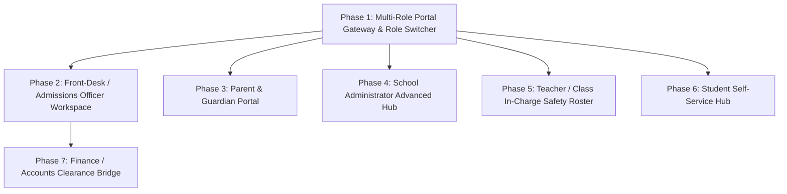

# Admissions Module — Role-Based Specifications & Implementation Roadmap

## 1. Executive Summary & Module Scope
The **Admissions Module** governs the full lifecycle of student entry into the institution—from public inquiry and front-desk lead intake, to parent application submissions, document verification, interview scheduling, fee clearance, and final administrative approval with class enrollment.

While the School Administrator workflow is currently active, this roadmap establishes the dedicated authentication flows, role permissions, and specialized interfaces for:
1. **Admissions / Front-Desk Officer**
2. **Parent / Guardian**
3. **Teacher / Class In-Charge**
4. **Student (Self-Service)**
5. **Finance / Accounts Officer**

---

## 2. Role-Based Access Control (RBAC) & Feature Matrix

| Feature / Action | Admin | Front-Desk Officer | Parent / Guardian | Teacher / In-charge | Student | Finance Officer |
| :--- | :---: | :---: | :---: | :---: | :---: | :---: |
| **Log Inquiries / Walk-in Leads** | Full | **Primary (Create/Edit)** | ❌ | ❌ | ❌ | ❌ |
| **Submit Online Child Application** | Manual | On Behalf | **Primary (Self-Service)** | ❌ | ❌ | ❌ |
| **Upload Identity & Certificates** | Full | Verify & Upload | Upload / Replace | View-Only | View-Only | ❌ |
| **Document Verification Queue** | Overrule | **Primary (Verify/Reject)** | ❌ | ❌ | ❌ | ❌ |
| **Schedule Interviews / Tests** | Full | **Primary (Calendar/Log)** | View & Confirm | ❌ | ❌ | ❌ |
| **Approve / Reject Admissions** | **Final Sign-off** | Draft / Recommend | ❌ | ❌ | ❌ | Concession Check |
| **Class Grade & Section Placement** | **Primary** | Suggest / Read | Read-Only | Read-Only | Read-Only | ❌ |
| **Assign / Re-order Roll Numbers** | **Primary** | Read-Only | Read-Only | Read-Only | Read-Only | ❌ |
| **Print / Generate ID Badges** | Full | **Primary Operator** | Download Digital | ❌ | View Digital | ❌ |
| **Primary Contact & Fee Payer Toggle** | Admin Edit | Front-Desk Edit | **Self-Service Toggle** | View-Only | ❌ | Billing Info |
| **Multi-Child / Sibling Switching** | Full Directory | ❌ | **Linked Children Only** | ❌ | ❌ | Billing Ledger |
| **Class Roster & Medical Blood Group** | Full | Read-Only | Own Child | **Class Roster View** | Own Profile | ❌ |
| **Submit Name/Data Correction** | Review/Edit | Receive & Process | Submit Request | ❌ | **Submit Request** | ❌ |
| **Admission Fee & Scholarship Tagging** | Override | Check Status | Pay / Upload Slip | ❌ | ❌ | **Primary Clearance** |

---

## 3. Data Schema Specifications

### A. Base User Entity (`users`)
- `id`: UUID (Primary Key)
- `email`: String (255, Unique, Indexed) — Institutional or parent primary login
- `phone_number`: String (20, Unique, Indexed) — SMS alerts and OTP authentication
- `password_hash`: String (255, Not Null)
- `user_role`: Enum (`ADMIN`, `TEACHER`, `STUDENT`, `PARENT`, `ADMISSIONS`, `FINANCE`)
- `first_name`: String (100, Not Null)
- `last_name`: String (100, Not Null)
- `profile_photo_url`: String (500, Nullable)
- `gender`: Enum (`MALE`, `FEMALE`, `OTHER`, Nullable)
- `date_of_birth`: Date (Nullable)
- `status`: Enum (`ACTIVE`, `INACTIVE`, `SUSPENDED`, `ARCHIVED`, Default: `ACTIVE`)
- `last_login_at`: Timestamp (Nullable)
- `created_at`: Timestamp (Default: `NOW()`)
- `updated_at`: Timestamp (Auto-update)

### B. Enrolled Student Profile (`student_profiles`)
- `id`: UUID (Primary Key)
- `user_id`: UUID (FK -> `users.id`, 1-to-1)
- `admission_number`: String (50, Unique, Indexed, Not Null)
- `current_class_section_id`: UUID (FK -> `class_sections.id`, Not Null)
- `roll_number`: String (20, Nullable)
- `admission_date`: Date (Not Null)
- `academic_year`: String (20, Not Null, e.g. `2026-2027`)
- `blood_group`: String (10, Nullable, e.g. `O+`, `B+`)
- `residential_address`: Text (Not Null)
- `emergency_contact_phone`: String (20, Not Null)
- `enrollment_status`: Enum (`ENROLLED`, `PROMOTED`, `SUSPENDED`, `DISCONTINUED`, `ARCHIVED`)
- `id_badge_issued`: Boolean (Default: `False`)

### C. Parent & Guardian Link (`parent_profiles` & `student_guardian_links`)
- `parent_id`: UUID (FK -> `parent_profiles.id`, Not Null)
- `student_id`: UUID (FK -> `student_profiles.id`, Not Null)
- `relationship_type`: Enum (`FATHER`, `MOTHER`, `LEGAL_GUARDIAN`)
- `is_primary_contact`: Boolean (Default: `True` — Recipient of emergency/absence SMS)
- `is_fee_payer`: Boolean (Default: `True` — Recipient of invoice & fee alerts)

### D. Admissions Inquiry & Pipeline (`admission_inquiries`)
- `id`: UUID (Primary Key)
- `inquiry_number`: String (50, Unique, e.g. `INQ-2026-0042`)
- `applicant_first_name`: String (100, Not Null)
- `applicant_last_name`: String (100, Not Null)
- `grade_applying_for`: String (50, Not Null)
- `parent_name`: String (100, Not Null)
- `parent_phone`: String (20, Not Null)
- `parent_email`: String (255, Not Null)
- `source`: Enum (`WALK_IN`, `PHONE_CALL`, `WEBSITE_FORM`, `REFERRAL`)
- `status`: Enum (`INQUIRY`, `APPLICATION_SUBMITTED`, `DOCUMENT_VERIFICATION`, `INTERVIEW_SCHEDULED`, `ADMIN_REVIEW`, `APPROVED`, `REJECTED`)
- `assigned_officer_id`: UUID (FK -> `admissions_officer_profiles.id`)
- `interview_scheduled_at`: Timestamp (Nullable)
- `interview_notes`: Text (Nullable)
- `created_at`: Timestamp

---

## 4. Multi-Role Authentication & Session Architecture

### A. Authentication Models
1. **Unified Portal Login**:
   - Single clean login screen with smart auto-detection:
     - Input: Email / Phone + Password (or OTP for Parents).
     - System inspects `user_role` and redirects to the designated workspace automatically:
       - `admin` -> Admin Dashboard & Pipeline Overview
       - `admissions` -> Front-Desk Officer Workspace
       - `parent` -> Parent Guardian Portal (Child Dashboard)
       - `teacher` -> Teacher Classroom Roster
       - `student` -> Student Academics & ID View
2. **Multi-Role User State (`AuthState`)**:
   - Managed via Riverpod: `currentAuthUserProvider` (`UserModel?`).
   - Active profile context:
     - `parentActiveChildIdProvider`: For parents with multiple siblings.
     - `teacherAssignedClassSectionProvider`: For classroom teachers.

---

## 5. Exhaustive Role-by-Role Implementation Phases

---

### Phase 1: Multi-Role Portal Gateway & Role Switcher
**Target User Roles**: All System Users during testing and portal entry  
**Primary Goal**: Provide a polished, intuitive entry point to launch directly into any user's role-specific workspace without requiring backend credentials.

#### 1. Screens to Build
- **`portal_gateway_screen.dart`**: Unified entry screen featuring:
  - Hero branding (`EduPulse Institutional Portals`).
  - Interactive role launcher cards:
    - 🏢 **School Administrator** (`/admin-portal`)
    - 📑 **Admissions / Front-Desk Officer** (`/frontdesk-workspace`)
    - 👨‍👩‍👧 **Parent / Guardian** (`/parent-portal`)
    - 👨‍🏫 **Teacher / Class In-Charge** (`/teacher-roster`)
    - 🎓 **Student** (`/student-hub`)
    - 💳 **Finance / Accounts Officer** (`/finance-clearance`)
  - Mock credential login tab (Email/Password with "Sign In" button that auto-detects role).
- **`role_switcher_pill.dart`**: Persistent topbar dropdown allowing instant role switching at any time during testing without losing context.

---

### Phase 2: Admissions / Front-Desk Officer Workspace `[COMPLETED]`
**Target User Role**: Admissions / Front-Desk Officer  
**Primary Responsibilities**:
- Log walk-in, phone, and web inquiries/leads with applicant and guardian details.
- Verify uploaded certificates (birth certificate, transfer slips, prior mark sheets).
- Schedule and log student/parent admission interview dates and results.
- Enter demographic data into draft enrollment records for admin sign-off.
- Trigger barcode/photo student ID badge generation and printing.
- Look up student directory for front-desk visitor verification.
- Track admissions metrics (leads vs. applications vs. confirmed admissions).

#### 1. Option A: Full Admissions Lifecycle Sidebar Fields
The front-desk workspace uses the comprehensive lifecycle sidebar structure:
1. 📊 **Dashboard** (`FrontDeskPage.dashboard`): Real-time admissions cockpit with KPI metric counters, quick inquiry modal, recent leads list, and upcoming interview agenda.
2. 📝 **Inquiries & Leads** (`FrontDeskPage.inquiries`): Walk-in & phone inquiry logging table with source filtering (`Walk-In`, `Phone`, `Web`, `Referral`), status management, and 1-tap "Convert to Application".
3. 📋 **New Application (Draft Intake)** (`FrontDeskPage.newApplication`): Full student admission draft form for front-desk operators registering walk-in parents.
4. 📄 **Document Verification** (`FrontDeskPage.documentQueue`): Screening studio with modal inspection of birth certificates, transfer certificates, and prior mark sheets with 1-tap Approve & Reject reasons.
5. 📅 **Interview Scheduler** (`FrontDeskPage.interviewScheduler`): Date, room, panel, and applicant slot booking system with status tracking (`Scheduled`, `Completed`, `Cancelled`).
6. 🪪 **Student ID Cards** (`FrontDeskPage.idBadgeStudio`): Interactive Front & Back high-res student badge preview with QR code, barcode, emergency contacts, blood group, and print simulation.
7. 🔍 **Student Directory Lookup** (`FrontDeskPage.studentLookup`): Instant reception search directory for student records and visitor verification.
8. 🚪 **Logout**: Dedicated logout action returning safely to the single credential sign-in gateway.

#### 2. Architecture & File Structure Built
- **[frontdesk_controller.dart](file:///c:/Users/rinku/OneDrive/Desktop/KVM/sms/frontend/lib/features/admissions/presentation/controllers/frontdesk_controller.dart)**: Riverpod state management for inquiries, verification queue, and interview slots.
- **[frontdesk_dashboard_screen.dart](file:///c:/Users/rinku/OneDrive/Desktop/KVM/sms/frontend/lib/features/admissions/presentation/screens/frontdesk/frontdesk_dashboard_screen.dart)**: Admissions overview cockpit.
- **[inquiry_desk_screen.dart](file:///c:/Users/rinku/OneDrive/Desktop/KVM/sms/frontend/lib/features/admissions/presentation/screens/frontdesk/inquiry_desk_screen.dart)**: Walk-in inquiry desk with modal lead logger.
- **[document_verification_queue_screen.dart](file:///c:/Users/rinku/OneDrive/Desktop/KVM/sms/frontend/lib/features/admissions/presentation/screens/frontdesk/document_verification_queue_screen.dart)**: Document screening queue and approval studio.
- **[interview_scheduler_screen.dart](file:///c:/Users/rinku/OneDrive/Desktop/KVM/sms/frontend/lib/features/admissions/presentation/screens/frontdesk/interview_scheduler_screen.dart)**: Interview slot scheduler.
- **[id_badge_studio_screen.dart](file:///c:/Users/rinku/OneDrive/Desktop/KVM/sms/frontend/lib/features/admissions/presentation/screens/frontdesk/id_badge_studio_screen.dart)**: Student photo badge generator studio.
- **[frontdesk_student_lookup_screen.dart](file:///c:/Users/rinku/OneDrive/Desktop/KVM/sms/frontend/lib/features/admissions/presentation/screens/frontdesk/frontdesk_student_lookup_screen.dart)**: Reception directory lookup.
- **[frontdesk_workspace_screen.dart](file:///c:/Users/rinku/OneDrive/Desktop/KVM/sms/frontend/lib/features/admissions/presentation/screens/frontdesk/frontdesk_workspace_screen.dart)**: Responsive scaffold, collapsible desktop sidebar, mobile navigation drawer, and top header.

---

### Phase 3: Parent & Guardian Portal
**Target User Role**: Parent / Guardian  
**Primary Responsibilities**:
- Complete and submit online application forms for new children.
- Upload digital scans of identity proofs and transfer documents.
- View enrolled child’s profile, assigned section, class in-charge, and roll number.
- Directly update residential address, email, and emergency contact numbers.
- Toggle who serves as primary contact for emergency and absence alerts.
- Switch between profiles of siblings enrolled in the institution.

#### 1. Screens & Views to Build
- **`parent_portal_screen.dart` (Family Dashboard)**:
  - **Sibling / Multi-Child Switcher**: Header bar tab/dropdown allowing parents with multiple enrolled children (e.g. Aarav Sharma & Kabir Sharma) to switch context seamlessly.
  - Child academic snapshot card: Assigned Grade, Section, Roll Number, Class In-Charge name, and Attendance summary.
- **`parent_application_screen.dart` (Online Child Intake)**:
  - Self-service intake wizard tailored for parents:
    - Step 1: Child demographics and photo upload.
    - Step 2: Grade selection and previous school info.
    - Step 3: Document upload dropzone (Birth cert, previous report card, parent ID).
    - Step 4: Submission confirmation with tracking reference (`APP-2026-XXXX`).
- **`parent_contact_manager_screen.dart` (Family Profile & Emergency Controls)**:
  - Editable home address, emergency outreach phone, and primary email.
  - Interactive toggle switches with mutual exclusion logic:
    - `Primary Absence Contact` (Father vs. Mother vs. Guardian)
    - `Authorized Billing & Fee Payer` (Father vs. Mother vs. Guardian)
- **`application_tracker_screen.dart`**:
  - Visual timeline tracking application status: *Submitted* ➔ *Document Verified* ➔ *Interview Scheduled* ➔ *Enrolled*.

---

### Phase 4: School Administrator Advanced Hub
**Target User Role**: School Administrator  
**Primary Responsibilities**:
- Evaluates and approves/rejects screened admission applications.
- Creates, edits, archives, and deletes official student records.
- Assigns students to an academic year, class grade, and section (e.g., Class 10-A).
- Assigns and re-orders student class roll numbers.
- Overrides student enrollment status (`ENROLLED`, `PROMOTED`, `SUSPENDED`, `DISCONTINUED`, `ARCHIVED`).
- Searches, filters, and exports student directories by grade, section, gender, or status.
- Audits student profile change history and guardian linkings.

#### 1. Screens & Views to Build
- **`admin_admissions_board_screen.dart` (Executive Intake Matrix)**:
  - Final sign-off queue for applications vetted by the Front Desk and cleared by Finance.
  - Approve dialog with class grade assignment, section placement, and roll number auto-sequencing.
- **`class_roll_assignment_screen.dart`**:
  - Drag-and-drop or alphabetical re-sequencing of class roll numbers within a section.
- **`student_status_override_modal.dart`**:
  - Administrative dialog to change enrollment status (`ENROLLED`, `PROMOTED`, `SUSPENDED`, `DISCONTINUED`, `ARCHIVED`) with mandatory audit reason logging.
- **`admissions_audit_log_screen.dart`**:
  - Chronological history of student modifications, enrollment status shifts, and guardian changes.

---

### Phase 5: Teacher / Class In-Charge Safety & Roster View
**Target User Role**: Teacher / Class In-charge  
**Primary Responsibilities**:
- Views the active class roster for their assigned section.
- Accesses student emergency contacts, parent phone numbers, and residential addresses.
- Views student medical/blood group information for classroom safety.
- Adds internal behavioral notes or observational tags.
- Restrictions: View-only for demographic, financial, and enrollment status fields.

#### 1. Screens & Views to Build
- **`teacher_class_roster_screen.dart`**:
  - Filterable class roster showing roll numbers, student names, photos, and quick indicators.
- **`student_safety_card_modal.dart`**:
  - Instant modal for classroom emergencies:
    - Prominent **Blood Group** badge (e.g., `O+`, `B-`) and medical alert tags.
    - 1-tap parent emergency phone dialer.
    - Residential address and designated primary guardian.
- **`teacher_observational_notes_card.dart`**:
  - Private teacher notes area for classroom behavior, student strengths, and observation tags.

---

### Phase 6: Student Self-Service Hub
**Target User Role**: Student  
**Primary Responsibilities**:
- Views own admission number, roll number, section, and enrolled subjects.
- Uploads or updates profile avatar (subject to admin approval).
- Submits correction requests for personal details (e.g., misspelled name) to the front desk.
- Restrictions: Read-only for academic and administrative records; cannot change class or enrollment status.

#### 1. Screens & Views to Build
- **`student_profile_hub_screen.dart`**:
  - Student identity card displaying official admission number, roll number, section, and class in-charge.
- **`digital_student_badge_view.dart`**:
  - Digital school pass with QR code, student photo, and valid session badge (`2026-2027`).
- **`profile_correction_request_dialog.dart`**:
  - Self-service form allowing student to flag clerical mistakes (e.g., misspelled name, wrong date of birth) and route tickets directly to the Front-Desk Officer queue.

---

### Phase 7: Finance & Accounts Officer Clearance Bridge
**Target User Role**: Finance / Accounts Officer  
**Primary Responsibilities**:
- Verifies payment of admission registration/application fees.
- Tags approved tuition concession / scholarship categories during enrollment.

#### 1. Screens & Views to Build
- **`admission_fee_clearance_screen.dart`**:
  - Table of pending admission fee records with payment slip preview.
  - Actions: 1-click **Confirm Fee Received** or **Flag Incomplete Payment**.
- **`scholarship_tagging_modal.dart`**:
  - Tag tuition concession category (e.g., *Merit Scholarship (25%)*, *Sibling Concession (15%)*, *Staff Ward (50%)*) before final administrative enrollment sign-off.

