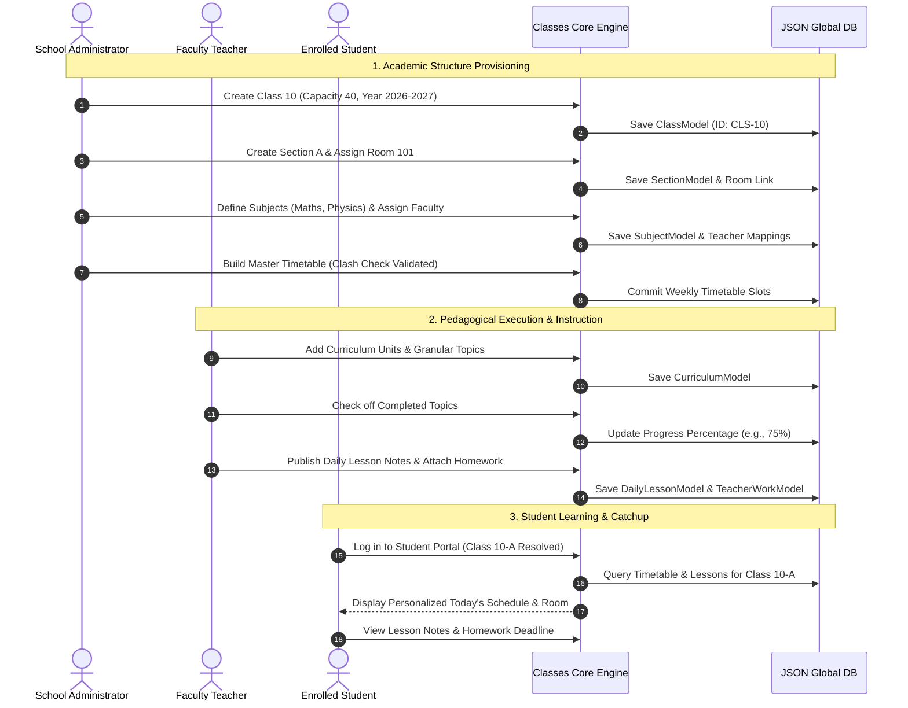

# EduPulse School Management System — Classes & Academic Module Specification

**Document Version:** 1.0.0  
**Status:** Approved for Implementation & Operations  
**Module Identifier:** `src/features/classes`  
**Primary Interface:** Academic Dean Console, Teacher Diary, Student & Parent Learning Portal  
**Companion Spreadsheet:** `EduPulse_Classes_Module_Specification.xlsx`

---

## 1. Executive Summary & Architecture

The **Classes & Academic Module** serves as the central operational backbone of the EduPulse School Management System. It orchestrates the entire educational lifecycle by connecting **Curricular Planning**, **Section Division**, **Faculty Allocation**, **Facility Scheduling**, and **Day-to-day Classroom Execution** into an integrated, role-governed ecosystem.

```
Institutional Root (Academic Year: 2026-2027)
       │
       ▼
   Class / Grade Level (e.g. Class 10, Grade 5)
       ├── Section Partitioning (Section A, B, C)
       │       └── Physical Classroom Allocation (Room 101, Lab B)
       │
       ├── Subject Catalog (Theory vs Practical / Labs)
       │       ├── Syllabus Units & Granular Topics Checklist
       │       └── Faculty Allocation (Cross-linked to Staff Directory)
       │
       ├── Master Timetable (Mon-Sun Weekly Grid, Period Timeslots, Break Slots)
       │       └── Intelligent Clash Prevention (Teacher & Room Collision Checks)
       │
       ├── Daily Lesson Planner (Session Notes, Period Linking, Publishing)
       │       └── Daily Homework Practice Attachments
       │
       └── Teacher Work (Homework, Term Projects, Worksheets, Lab Reports)
               └── Student Submission Guidelines & Teacher Review Lifecycle
```

---

## 2. The 9 Core Functional Submodules

| # | Submodule Name | Flutter Component | Core Purpose | Primary Managing Role | Data Scope |
| :---: | :--- | :--- | :--- | :---: | :--- |
| **1** | **Academic Classes** | `AdminClassesListScreen` / `ClassFormScreen` | Define grade levels, academic sessions, capacity limits, section mapping, and assign primary Class Teachers. | Administrator | School-wide (All Classes) |
| **2** | **Section Management** | `SectionsManagementScreen` / `SectionModal` | Partition classes into balanced sections (A, B, C), enforce quotas, and allocate home rooms. | Administrator | Class-specific |
| **3** | **Subject Catalog** | `SubjectsManagementScreen` / `SubjectModal` | Curate Theory & Practical courses, configure Max/Passing marks, and map educators. | Administrator | Class-specific |
| **4** | **Curriculum & Syllabus** | `CurriculumManagementScreen` / `CurriculumListScreen` | Organize subject syllabi into units/chapters with topic checklists and live progress % tracking. | Admin & Teacher | Subject & Class specific |
| **5** | **Daily Lesson Planner** | `DailyLessonsScreen` / `LessonModal` | Digital teacher diary for daily teaching notes, learning objectives, and attached homework. | Teacher & Admin | Class & Section specific |
| **6** | **Master Timetable** | `TimetableManagementScreen` / `TimetableViewScreen` | 7-day schedule matrix, period timings, recess intervals, and automated clash detection. | Administrator | Class & Section specific |
| **7** | **Classroom Facilities** | `ClassroomManagementScreen` / `ClassroomsViewScreen` | Campus facility inventory, sequential form input (Room Number, Floor, Seats, Status), and Activate/Deactivate lifecycle controls. | Administrator | Campus-wide |
| **8** | **Assignments** | `TeacherWorkManagementScreen` | Multi-type coursework assignment (Homework, Projects, Worksheets) with review lifecycle. | Teacher & Admin | Class & Subject specific |
| **9** | **Faculty Allocation** | `ClassDetailsScreen` / `ClassesLookup` | Map educators from the Staff Directory without duplicating personal or salary data. | Administrator | Cross-Directory Matrix |

---

## 3. Comprehensive Data Dictionary & Model Schemas

### 3.1 Class Entity (`ClassModel`)
- **`id`** (`String`, Mandatory): Unique institutional identifier (e.g., `CLS-10`, `cls-1`).
- **Sequential Creation & Edit Form Layout**:
  1. **Academic Year (`academicYear`)** (`String`, Mandatory): Dropdown selection using existing supported institutional years (e.g., `2026-2027`, `2027-2028`, `2028-2029`).
  2. **Classroom (`classroomId`)** (`String?`, Optional): Dropdown populated from existing classroom records in the Class Rooms module. Reuses existing classroom data and identifiers. If no classrooms exist, presents an explicit prompt instructing the user to create a classroom in the Class Rooms module. (Does not create classrooms from this form).
  3. **Class Name (`name`)** (`String`, Mandatory): Text input for class title (e.g. *"Class 10"*, *"Grade 5"*).
  4. **Class Code (`code`)** (`String`, Mandatory): Auto-generated unique code (e.g. *"CLS-10"*); validated for system-wide uniqueness.
  5. **Class Strength (`capacity`)** (`int`, Mandatory): Simple numeric input for class student strength (e.g. `25`); validated $> 0$.
  6. **Status (`status`)** (`String`, Mandatory): Dropdown selection between `'Active'` and `'Inactive'`.
- **Academic Classes Screen Design (formerly Class List)**:
  - **Navigation & Breadcrumb**:
    - Heading/Breadcrumb clearly structured as: `Dashboard / Classes / Academic Classes`.
  - **Top Controls**:
    1. **Academic Year Filter**: Dropdown filtering classes by session.
    2. **Status Filter**: Dropdown filtering by `'All'`, `'Active'`, `'Inactive'`.
    3. **Search Field**: Real-time filtering by Class Name, Code, Academic Year, and Room Number.
    4. **Export JSON Button**: Prominently accessible on desktop and mobile; triggers JSON preview dialog displaying formatted classes and sections data with one-click copy to clipboard and file download.
    5. **Add New Class Button**: Primary action opening the 6-field sequential modal with Academic Year dropdown.
  - **Responsive Layout**:
    - **Desktop / Wide Screens**: Compact data table displaying columns in the exact 8-column order. Academic Year, Class Code, Class Name, Section Name, Classroom / Room Number, Class Strength, and Status are sortable in ascending or descending order using their header arrows; Action is not sortable.
      1. **Academic Year**: Text display of academic session.
      2. **Class Code**: Underlined to indicate clickability; clicking opens the Class Details page.
      3. **Class Name**: Underlined to indicate clickability; clicking opens the Class Details page.
      4. **Section Name**: Displays the individual section name (e.g. `Section A`, `Section B`, or `—` if none). Underlined to indicate clickability; clicking Section opens the existing Sections page pre-filtered to the selected class.
      5. **Classroom / Room Number**: Underlined room number/name; clicking opens the existing Classroom facilities page for that room or room details. Dynamically resolves the specific classroom assigned to that individual section (`sec.classroomId`), or the class-level classroom if unassigned at the section level. Does not assume all sections use the same room.
      6. **Class Strength**: Displays purely the simple numeric capacity value, such as `25` (never combined as `25/40`).
      7. **Status**: Active/Inactive status badge, cleanly aligned.
      8. **Action**: 3-dots popup menu containing View Details, Edit Class, Deactivate/Activate, and Delete. The `Assign Room` option is removed from the menu.
    - **Separate Section Entries / Rows**:
      - If a class has multiple sections (e.g., Section A and Section B), each section is rendered as a distinct entry/row in the Academic Classes table rather than combining them into a comma-separated string `A, B`.
      - Each row displays its individual section name and its own designated classroom assignment.
        - Editing a row's classroom updates that section's assignment; editing a class outside a section row updates the class-level classroom.
        - Reuses existing class and section data structures without creating duplicate class records.
    - **Mobile / Narrow Screens**: Stacked card layout displaying all class and section details with underlined clickable Class Code, Class Name, individual Section (opens Sections page), Classroom link (opens Classroom page), pure numeric class strength, and 3-dots action menu without `Assign Room`.
- **`gradeLevel`** (`int`, Mandatory): Numerical grade level (1-12; 0 for Kindergarten), auto-derived or explicit.
- **`classTeacherId`** (`String?`, Optional): Foreign Key $\rightarrow$ `StaffModel.id`.
- **`customFields`** (`Map<String, String>`, Optional): School-specific attributes (e.g., `{'Stream': 'Science'}`).

### 3.2 Section Entity (`SectionModel`)
- **`id`** (`String`, Mandatory): Unique identifier (e.g., `sec-10a`).
- **`classId`** (`String`, Mandatory): Foreign Key $\rightarrow$ `ClassModel.id`.
- **`name`** (`String`, Mandatory): Section label (e.g. *"Section A"*, *"Section B"*).
- **`capacity`** (`int`, Mandatory): Maximum student capacity for this division.
- **`classroomId`** (`String?`, Optional): Foreign Key $\rightarrow$ `ClassroomModel.id`.
- **`classTeacherId`** (`String?`, Optional): Foreign Key $\rightarrow$ `StaffModel.id`.
- **`status`** (`String`, Mandatory): `'Active'` or `'Inactive'`.
- **Section Creation & Edit Workflow (`openSectionModal`)**:
  - **Class Selection**: Dropdown (`DropdownButtonFormField<String>`) populated from all available classes in `lookup.classes`, allowing the user to select the correct class using its existing ID. Selecting a class automatically selects that class's assigned classroom, if present.
  - **Classroom / Room Number Selection**: Dropdown (`DropdownButtonFormField<String?>`) populated from existing classroom records in `lookup.classrooms`, displaying room name, floor, capacity, and active room collision checks (`roomsBlockedFor`). Allows selection using existing room IDs.
  - **Save Section**: Saves the new or updated section with the selected `classId` and `roomId`. If the parent class does not yet have a direct classroom assigned, synchronizes the selected classroom to the parent class's `classroomId` so the Academic Classes display immediately reflects the assigned classroom. Section and classroom assignments reflect dynamically in the Academic Classes table.
- **Sections Directory**: Class, Section Name, Class Teacher, Room Number, Enrolled, and Status columns are sortable from their header arrows. For administrators, the underlined class name opens that class's Academic Classes details, assigned Room Numbers open the corresponding classroom details, and assigned Class Teachers open their Staff Directory profile.

### 3.3 Subject Entity (`SubjectModel`)
- **`id`** (`String`, Mandatory): Unique subject identifier (e.g. `sub-math-10`).
- **`classId`** (`String`, Mandatory): Foreign Key $\rightarrow$ `ClassModel.id`.
- **`name`** (`String`, Mandatory): Subject title (e.g. *"Mathematics"*, *"Physics"*).
- **`code`** (`String`, Mandatory): Official course code (e.g. *"MTH101"*).
- **`type`** (`String`, Mandatory): `'Theory'` or `'Practical'`.
- **`syllabus`** (`String?`, Optional): Course syllabus document text or link.
- **`teacherId`** (`String?`, Optional): Foreign Key $\rightarrow$ `StaffModel.id`.
- **`maxMarks`** (`int`, Mandatory): Total assessment marks (Default `100`).
- **`passMarks`** (`int`, Mandatory): Minimum passing benchmark (Default `35`).

### 3.4 Curriculum Unit Entity (`CurriculumModel`)
- **`id`** (`String`, Mandatory): Unique curriculum chapter identifier.
- **`classId`** (`String`, Mandatory): Foreign Key $\rightarrow$ `ClassModel.id`.
- **`subjectId`** (`String`, Mandatory): Foreign Key $\rightarrow$ `SubjectModel.id`.
- **`title`** (`String`, Mandatory): Unit heading (e.g. *"Differential Calculus"*).
- **`description`** (`String`, Optional): Learning outcomes and pedagogical scope.
- **`topics`** (`List<String>`, Mandatory): Granular topic breakdown checklist.
- **`completedTopics`** (`int`, Mandatory): Checked-off topics count ($0 \le completed \le topics.length$).
- **`progress`** (`double`, Calculated): Live formula: $completedTopics / topics.length \times 100\%$.

### 3.5 Daily Lesson Entity (`DailyLessonModel`)
- **`id`** (`String`, Mandatory): Unique lesson log identifier.
- **`classId`** (`String`, Mandatory): Foreign Key $\rightarrow$ `ClassModel.id`.
- **`sectionId`** (`String`, Optional): Foreign Key $\rightarrow$ `SectionModel.id`.
- **`subjectId`** (`String`, Mandatory): Foreign Key $\rightarrow$ `SubjectModel.id`.
- **`teacherId`** (`String`, Mandatory): Foreign Key $\rightarrow$ `StaffModel.id`.
- **`periodLabel`** (`String`, Optional): Timetable period slot label (e.g. *"Period 1 (09:00 - 09:45)"*).
- **`date`** (`DateTime`, Mandatory): Instruction session date.
- **`title`** (`String`, Mandatory): Daily topic title.
- **`notes`** (`String`, Optional): Detailed classroom lecture notes and formulas.
- **`homework`** (`String`, Optional): Daily assigned practice exercises.
- **`status`** (`String`, Mandatory): `'Published'` (visible to students) or `'Draft'`.

### 3.6 Master Timetable Entry (`TimetableEntryModel`)
- **`id`** (`String`, Mandatory): Unique timetable slot identifier.
- **`classId`** (`String`, Mandatory): Foreign Key $\rightarrow$ `ClassModel.id`.
- **`sectionId`** (`String`, Mandatory): Foreign Key $\rightarrow$ `SectionModel.id`.
- **`subjectId`** (`String`, Mandatory): Foreign Key $\rightarrow$ `SubjectModel.id`.
- **`teacherId`** (`String`, Mandatory): Foreign Key $\rightarrow$ `StaffModel.id`.
- **`classroomId`** (`String?`, Optional): Foreign Key $\rightarrow$ `ClassroomModel.id`.
- **`isBreak`** (`bool`, Mandatory): `true` for Recess/Lunch intervals; `false` for academic periods.
- **`title`** (`String?`, Optional): Custom slot title for break periods (e.g. *"Lunch Break"*).
- **`dayOfWeek`** (`int`, Mandatory): $1 = \text{Monday}$ through $7 = \text{Sunday}$.
- **`startTime`** (`String`, Mandatory): 24-hour format string (e.g. `"09:00"`).
- **`endTime`** (`String`, Mandatory): 24-hour format string (e.g. `"09:45"`).

### 3.7 Classroom Facility Entity (`ClassroomModel`)
- **`id`** (`String`, Mandatory): Unique room identifier (e.g. `room-101`).
- **Sequential Creation & Edit Form Layout**:
  1. **Room Number (`name`)** (`String`, Mandatory): Physical room number / title (e.g. *"205"*, *"Room 101"*).
  2. **Floor (`floor`)** (`String`, Optional): Floor elevation within building wing (e.g. *"1st Floor"*, *"Ground Floor"*).
  3. **Seats - Total Capacity (`capacity`)** (`int`, Mandatory): Total student desk/seating quota (validated $> 0$).
  4. **Status (`status`)** (`String`, Mandatory): Explicit selection between `'Available'` (default) and `'Unavailable'`.
- **`building`** (`String`, Optional): Campus wing / building (e.g. *"Science Block"*).
- **`roomType`** (`String`, Mandatory): `'Theory'` | `'Lecture Hall'` | `'Practical'`.
- **3-Dots (⋮) Action Menu Layout**:
  - Located in the **Action** column of the Classroom Inventory table.
  - Clicking the vertical 3-dots button reveals the contextual action menu:
    1. **View** (`Icons.visibility_outlined`, Teal `#109F83`): Opens the classroom details summary modal displaying room specs and assigned class/section.
    2. **Edit** (`Icons.edit_outlined`, Blue `#3B82F6`): Opens the edit modal with the 4 ordered fields prefilled.
    3. **Deactivate / Activate** (Amber `#F59E0B` / Green `#109F83`):
       - If currently `Available`: Displays **Deactivate** (`Icons.block_outlined`) to mark the room as `Unavailable` when not in use.
       - If currently `Unavailable`: Displays **Activate** (`Icons.check_circle_outline`) to restore it to `Available` whenever required.
    4. **Delete** (`Icons.delete_outline`, Red `#EF4444`): Prompts a confirmation dialog before removing unassigned rooms.

### 3.8 Teacher Work Entity (`TeacherWorkModel`)
- **`id`** (`String`, Mandatory): Unique assignment identifier.
- **`title`** (`String`, Mandatory): Assignment title.
- **`classId`** (`String`, Mandatory): Foreign Key $\rightarrow$ `ClassModel.id`.
- **`sectionId`** (`String?`, Optional): Section target.
- **`subjectId`** (`String`, Mandatory): Foreign Key $\rightarrow$ `SubjectModel.id`.
- **`teacherId`** (`String`, Mandatory): Foreign Key $\rightarrow$ `StaffModel.id`.
- **`workType`** (`String`, Mandatory): `'Homework'` | `'Project'` | `'Worksheet'` | `'Lab Report'` | `'Reading'`.
- **`dueDate`** (`DateTime`, Mandatory): Submission deadline date.
- **`status`** (`String`, Mandatory): `'Assigned'` $\rightarrow$ `'In Progress'` $\rightarrow$ `'Submitted'` $\rightarrow$ `'Reviewed'`.
- **`instructions`** (`String`, Optional): Detailed task guidance.
- **`submissionGuidelines`** (`String`, Optional): Submission format specifications.
- **`academicYear`** (`String`, Mandatory): Academic year session (e.g. `"2026-2027"`).

### 3.9 Faculty Allocation Entity (`ClassTeacherAssignmentModel`)
- **`id`** (`String`, Mandatory): Unique assignment identifier (e.g. `cta-cls-10-sub-math-tch-1`).
- **`classId`** (`String`, Mandatory): Foreign Key $\rightarrow$ `ClassModel.id`.
- **`sectionId`** (`String?`, Optional): Foreign Key $\rightarrow$ `SectionModel.id`.
- **`subjectId`** (`String`, Mandatory): Foreign Key $\rightarrow$ `SubjectModel.id`.
- **`teacherId`** (`String`, Mandatory): Foreign Key $\rightarrow$ `StaffModel.id`.
- **`academicYear`** (`String`, Mandatory): Academic year session (e.g. `"2026-2027"`).
- **`assignedAt`** (`DateTime`, Mandatory): Assignment timestamp.
- **`status`** (`String`, Mandatory): `'Active'` or `'Inactive'`.
- **`role`** (`String`, Mandatory): `'Subject Teacher'`, `'Class Teacher'`, or `'Assistant Teacher'`.

---

## 4. End-to-End User Flows & Journeys



---

## 5. Role-Based Access Control (RBAC) Matrix

| Feature / Operation | Administrator | Teacher / Faculty | Student | Parent / Guardian | Front-Desk |
| :--- | :---: | :---: | :---: | :---: | :---: |
| **View Classes Directory** | Full (All Classes) | Assigned Classes Only | Enrolled Class Only | Ward's Class Only | Read Directory |
| **Create / Edit / Delete Class** | **YES** | NO | NO | NO | NO |
| **Manage Custom Field Schemas** | **YES** | NO | NO | NO | NO |
| **Create / Manage Sections** | **YES** | NO | NO | NO | NO |
| **Create / Manage Subjects** | **YES** | NO | NO | NO | NO |
| **Configure Grading Thresholds** | **YES** | NO | NO | NO | NO |
| **View Curriculum & Topics** | **YES** | **YES** | **YES** (Read-Only) | **YES** (Read-Only) | NO |
| **Author Curriculum Units** | **YES** | Assigned Subjects | NO | NO | NO |
| **Update Topic Progress (%)** | **YES** | Assigned Subjects | NO | NO | NO |
| **View Timetable Schedules** | Full (All Classes) | Own Schedule + Class | Enrolled Class | Ward's Class | Lookup Only |
| **Configure Master Timetable** | **YES** | NO | NO | NO | NO |
| **Access Class Rooms Module** | **YES** | NO *(Hidden from Teacher Portal)* | NO | NO | NO |
| **Create / Edit Classroom** | **YES** | NO | NO | NO | NO |
| **Activate / Deactivate Classroom** | **YES** | NO | NO | NO | NO |
| **Assign Class & Subject Faculty**| **YES** | NO | NO | NO | NO |
| **View Daily Lesson Logs** | **YES** | **YES** | Enrolled Class | Ward's Class | NO |
| **Publish Daily Lesson Notes** | **YES** | Assigned Classes | NO | NO | NO |
| **Create Homework & Projects** | **YES** | Assigned Classes | NO | NO | NO |
| **Delete Homework / Teacher Work**| NO *(Protected)* | Authoring Teacher | NO | NO | NO |
| **Review & Evaluate Submissions** | **YES** | Assigned Teacher | NO | NO | NO |

---

## 6. Operational Validation Rules & Collision Engines

1. **Room Collision Prevention (`RUL-TIM-02`)**:
   - The engine validates that no physical room can be booked for multiple classes during overlapping time intervals on the same weekday:
   $$\text{Interval}_A \cap \text{Interval}_B = \emptyset \quad \forall \; \text{Slots with } roomId_A == roomId_B \land day_A == day_B$$
2. **Teacher Clash Prevention (`RUL-TIM-01`)**:
   - The engine ensures no faculty member is booked to teach two distinct classes at the same time:
   $$\text{Interval}_A \cap \text{Interval}_B = \emptyset \quad \forall \; \text{Slots with } teacherId_A == teacherId_B \land day_A == day_B$$
3. **Section Capacity Ceiling (`RUL-SEC-02`)**:
   - Administrators cannot reduce a section's maximum capacity below the count of students currently admitted and active in that section.
4. **Curriculum Clamping (`RUL-CUR-01`)**:
   - Topic completion progress is mathematically clamped: $0 \le \text{completedTopics} \le \text{topics.length}$.
5. **Teacher Work Administrative Deletion Shield (`RUL-WRK-02`)**:
   - Administrators have institutional read oversight over homework assignments, but cannot delete teacher-authored assignments; only the issuing faculty member can delete their coursework.
6. **Student Data Isolation Boundary (`RUL-SEC-03`)**:
   - The student portal automatically scopes all data queries to the student's enrolled grade and section from their admission record. Unenrolled classes cannot be accessed.
7. **Classroom Deactivation Safety Guard (`RUL-ROM-02`)**:
   - A classroom cannot be deactivated (marked as `Unavailable`) if it is currently assigned as the base room to an active class or section:
   $$\text{Deactivation Prohibited if } \exists \; c \in \text{Classes} \text{ where } c.classroomId == roomId \lor \exists \; s \in \text{Sections} \text{ where } s.classroomId == roomId$$
   - Prevents orphaned class/section room assignments. The administrator must first reassign the class/section to another available room before deactivating the facility.
8. **Class Strength & Classroom Capacity Ceiling (`RUL-CLS-01`)**:
   - Class strength must be a positive integer ($> 0$).
   - When a classroom is assigned to a class, the class strength cannot exceed the selected classroom's total student seating capacity ($capacity_{\text{class}} \le capacity_{\text{room}}$).
9. **Class Name & Code Uniqueness (`RUL-CLS-02`)**:
   - Each class record must maintain a distinct, case-insensitive class name and unique class code across the institution to prevent duplicate records.
10. **Classroom Module Reusability & Isolation (`RUL-CLS-03`)**:
    - The Class List module reuses existing classroom entities from the Class Rooms module; it does not instantiate or alter classroom records. If no classrooms exist, the user is directed to the Class Rooms module.
11. **Live Dynamic Enrollment Derivation (`RUL-CLS-04`)**:
    - Enrolled student counts in the Class List are computed reactively from actual active student admission records, dynamically refreshing upon enrollment, transfer, or removal.
12. **Dynamic Subject-Qualified Teacher Filtering (`RUL-TCH-01`)**:
    - When assigning a teacher to a class/subject, the system dynamically filters the teacher dropdown based on the selected subject.
    - Only teachers who are qualified or assigned to teach the selected subject are displayed:
      - **Maths / Mathematics / Advanced Mathematics**: Filters to faculty with Mathematics department, designation (e.g. Mathematics HOD, PGT Maths), specialization (e.g. Pure Calculus & Analytical Geometry), or existing mathematics assignments.
      - **Physics**: Filters to faculty in Physics department, designation (e.g. PGT Physics, HOD Science & Physics), specialization (Mechanics & Quantum Physics), or existing physics assignments.
      - **Chemistry**: Filters to faculty in Chemistry department, designation (e.g. Chemistry Faculty, PGT Chemistry), specialization (Organic Chemistry & Thermodynamics), or existing chemistry assignments.
      - **Science / General Science / Natural Science**: Filters to natural science faculty (Physics, Chemistry, General Science, Biology) while strictly excluding Social Science and Computer Science.
      - **English / Literature**: Filters to faculty in English department, designation (e.g. English Faculty), specialization (English Literature & Language), or existing English assignments.
      - Other subjects (Computer Science/AI, Social Science, Hindi, Physical Education) are similarly matched by domain without displaying unrelated teachers.
    - If no matching teacher exists for the chosen subject, the dropdown displays a clear message: `"No teachers available for this subject."` and disables assignment submission.
    - Switching the Class clears the selected Subject and Teacher; switching the Subject clears the selected Teacher to prevent invalid or mismatched assignments.

---

## 7. Class Details & Section Navigation Specification

### 7.1 Class and Section Navigation
- When the administrator opens Class List and selects a class, the system displays the Class Details screen for that exact class.
- All existing sections for the class (e.g. `Section A`, `Section B`) are displayed at the top in a dedicated interactive Section Navigation Bar with live enrollment count badges (e.g. `Section A (15)`).
- When a section is selected, only that section's independent information is displayed.
- Each section maintains completely independent data:
  - **Classroom**: Independent room assignment (`selectedSection.classroomId`). Section A's room is never automatically copied into Section B.
  - **Students**: Enrolled students whose profile matches the selected section (`student.sectionId == selectedSection.id`).
  - **Teacher Assignments**: Teachers placed on this specific section (`assignment.sectionId == selectedSection.id`) plus the section's class teacher (`selectedSection.classTeacherId`).
  - **Subjects**: Class subjects mapped to the specific teacher assigned for this section.
  - **Curriculum**: Syllabus units, chapters, topics, and completion status.
  - **Timetable**: Scheduled weekly periods filtered strictly by `selectedSection.id`.
- If a section has no data for a category, a clear, friendly empty state is shown with a prompt action button (e.g. `Assign Student`, `Assign Teacher`, `Add Subject`, `Add Unit`).
- Section information is retrieved and keyed exclusively using unique class and section IDs (`classId`, `sectionId`).

### 7.2 Summary Tiles (6 Rectangular Cards)
- Displays 6 distinct rectangular cards in a responsive grid:
  1. **Classroom**: Room number / name, floor, seating capacity, and real-time availability status.
  2. **Teachers**: Total faculty assigned to this section and Section Class Teacher name.
  3. **Students**: Count of enrolled students in this section and section capacity ceiling (`enrolled/capacity`).
  4. **Subjects**: Total configured subjects with Theory vs Practical distribution.
  5. **Units**: Total curriculum units with completed topics count and percentage progress.
  6. **Periods**: Total weekly timetable periods scheduled for this section.
- **Responsive Layout**:
  - **Desktop ($\ge 960$px)**: 3 columns (2 rows of 3 cards).
  - **Tablet ($640$px to $959$px)**: 2 columns (3 rows of 2 cards).
  - **Mobile ($< 640$px)**: 1 column (6 stacked rectangular cards).
- **Aesthetics & Typography**:
  - Increased card padding ($14-16$px) and generous spacing to prevent unnecessary horizontal scrolling.
  - $44 \times 44$ icon containers with harmonious theme tinting.
  - Complete teacher names, room numbers, and descriptive subtitles are rendered with flexible text wrapping to eliminate truncation or text cutoff.

### 7.3 Section Detail Tabs
The screen organizes section details into 6 separate tabs:
1. **Overview**:
   - Section Overview card with enrollment progress bar against capacity.
   - Independent Classroom Details card with room specs and quick edit/assign actions.
   - Section Class Teacher card with full faculty profile and assign/change action.
   - Curriculum & Syllabus summary and Timetable preview.
2. **Teacher Assignment** (*Strictly separated from Curriculum*):
   - Section Class Teacher featured card.
   - List of subject faculty assignments for this section (`a.sectionId == selectedSection.id`), displaying full teacher name, designation, department, assigned subject, and room number.
   - "+ Assign Teacher" modal selecting existing staff from Staff Directory without duplicate records.
   - "Remove" action with confirmation dialog, which removes the section assignment without deleting the staff member's record in the Staff Directory.
3. **Students**:
   - List of enrolled students in this section with live instant search by student name, admission number, or roll number.
   - "+ Assign Student" modal selecting from admitted students without duplicate records.
   - "+ New Admission" shortcut opening the admission registration form.
   - "Remove from Section" action with confirmation dialog, which clears `sectionId` and `section` on the student profile while preserving the student admission record intact.
4. **Subjects**:
   - Configured subjects for the class with Subject Code badges, type badges (Theory/Practical), marks passing criteria, and assigned faculty for this section.
   - "+ Add Subject" modal (admin only).
5. **Curriculum**:
   - Syllabus chapters, units, and topic lists with interactive completion checkboxes (for teachers and admins).
   - Animated progress ring and completion percentage.
   - "+ Add Curriculum" modal (admin only).
6. **Timetable**:
   - Displays weekly periods in a clean table/grid with days as rows and periods as columns.
   - Fully supports subjects, assigned faculty, breaks, and lunch, strictly preserving configured start and end times without resetting to defaults.
   - Embedded with `lockSection: true`, ensuring Section A's schedule never overlaps or leaks into Section B.

### 7.4 Role-Based Access Control (RBAC)
- **Administrator**: Complete administrative authority to manage all classes, sections, classroom assignments, faculty placements, students, curriculum, and timetables.
- **Teacher**: Scoped access to view assigned classes/sections, their students, subjects, curriculum, and timetables. Allowed to update topic completion progress. Classroom management controls are completely hidden from teachers.
- **Student**: Read-only access strictly locked to the student's enrolled class and section. Cannot switch to other sections, cannot view administrative edit controls, and cannot view unrelated students' private contact details.

---

## 8. Dynamic Faculty Assignment & Assignments Module Specification

### 8.1 4-Step Interactive Assignment Workflow
Faculty subject allocation is performed in-context via the Class Details module (`ClassDetailsScreen` Section Faculty tab) and coursework assignments (`TeacherWorkManagementScreen` / Assignments module), enforcing a strict, hierarchical 4-step selection workflow without requiring a redundant standalone screen:

1. **Step 1: Class Selection (`ClassModel`)**:
   - The administrator selects the target Class from a dropdown populated with all institutional classes (`lookup.classes`).
   - Selecting a new class automatically resets any previously selected Subject and Teacher, ensuring that only subjects and teachers relevant to the newly selected class are presented.

2. **Step 2: Subject Selection (`SubjectModel`)**:
   - The Subject dropdown displays only subjects configured for the selected class (`lookup.subjectsForClass(selectedClass.id)`).
   - If no subjects are configured for the class, an informative placeholder/message directs the user.
   - Changing the selected subject immediately clears the previously selected Teacher and dynamically triggers the teacher qualification filter.

3. **Step 3: Dynamically Filtered Teacher Selection (`StaffModel`)**:
   - The Teacher dropdown is filtered dynamically using `lookup.qualifiedTeachersForSubject(selectedSubject.name)`.
   - Filters teachers based on institutional qualification criteria (department, designation, specialization, and historical subject teaching assignments).
   - Strictly prohibits displaying unrelated teachers in the dropdown (e.g., Mathematics teachers cannot be assigned to English or Chemistry).
   - If no qualified teacher is found in the Staff Directory, the dropdown is disabled and displays a prominent warning card: `"No teachers available for this subject."`.

4. **Step 4: Verification & Persistent Allocation**:
   - Upon selecting a qualified teacher, the UI renders an educator preview card showing full name, designation, department, and academic specialization.
   - Submitting "Assign Teacher" validates all required identifiers (`classId`, `subjectId`, `teacherId`), verifies duplicate assignment prevention, commits the record to `teacherAssignmentsControllerProvider`, updates the `SubjectModel`'s `teacherId`, and refreshes the directory table.
   - Preserves all existing staff data, class configurations, and unrelated modules.

---

## 9. Timetable Module Specification: Break, Lunch, and Availability Customization

### 9.1 Standard Breaks & Lunch Reservation
- **Morning Break**:
  - **Schedule**: `10:15 AM to 10:30 AM` (between Period 3 `09:30 - 10:15` and Period 4 `10:30 - 11:15`).
  - **Display Title**: `Break` (with morning coffee / tea icon `Icons.free_breakfast_outlined` and distinct blue badge styling).
  - **Reservation Rule**: Strictly reserved for break time; cannot have any class, subject, teacher, or classroom assigned (`subject_id = ''`, `teacher_id = ''`, `classroom_id = null`).
- **Mid-day Lunch**:
  - **Schedule**: `12:00 PM to 12:40 PM` (between Period 5 `11:15 - 12:00` and Period 6 `12:40 - 13:25`).
  - **Display Title**: `Lunch` (with restaurant / dining icon `Icons.restaurant_outlined` and warm amber/orange badge styling).
  - **Reservation Rule**: Strictly reserved for lunch; cannot have any class, subject, teacher, or classroom assigned (`subject_id = ''`, `teacher_id = ''`, `classroom_id = null`).

### 9.2 Conflict Prevention & Overlap Rules
- **Teaching Period Scheduling**:
  - A teaching/subject period with interval $[S, E)$ is strictly prohibited from overlapping Break or Lunch:
    - Overlaps Break $[10:15, 10:30)$ iff $S < 10:30 \land 10:15 < E$. Rejection error: `Cannot schedule class during Break (10:15 AM - 10:30 AM).`
    - Overlaps Lunch $[12:00, 12:40)$ iff $S < 12:40 \land 12:00 < E$. Rejection error: `Cannot schedule class during Lunch (12:00 PM - 12:40 PM).`
    - Overlaps custom break $[S_b, E_b)$ iff $S < E_b \land S_b < E$. Rejection error: `Cannot schedule class during <Title> (<S_b> - <E_b>).`
  - Exact boundary alignments (e.g. Period 3 ending at 10:15, Period 4 starting at 10:30, Period 5 ending at 12:00, Period 6 starting at 12:40) are valid and collision-free.
- **Break Creation**:
  - A break period cannot overlap any existing scheduled class period on that day. Rejection error: `Break time overlaps with an existing class period (<startTime> - <endTime>).`

### 9.3 Cross-View Representation (Grid, Table View, and Day List)
1. **Regular Timetable Grid (`_buildTimetableGrid`)**:
   - `kStandardSlots` includes Period 1 (08:00–08:45), Period 2 (08:45–09:30), Period 3 (09:30–10:15), **Break (10:15–10:30)**, Period 4 (10:30–11:15), Period 5 (11:15–12:00), **Lunch (12:00–12:40)**, Period 6 (12:40–13:25), Period 7 (13:25–14:10).
   - In `_buildBreakRow`, the Time / Day column renders the slot title and formatted AM/PM hours.
   - For all active days Monday to Saturday, each break cell displays a styled badge with icon and title.
   - Tapping any cell opens the period modal pre-configured with `isBreak = true`, the day, and slot times for instant customization.
2. **Weekly/Monthly Table View (`_buildTimetableTableView`)**:
   - Default Break and Lunch slots are synthesized and merged for all weekdays Monday to Saturday if not already explicitly present in records.
   - All rows are chronologically sorted by day of week then start time.
   - In DataTable rows:
     - **Subject Column**: Styled Break / Lunch badge with icon (`Icons.restaurant_outlined` / `Icons.free_breakfast_outlined`).
     - **Teacher Column**: Rendered as `—` (dash) to clearly convey reservation without teacher assignment.
     - **Classroom Column**: Rendered as `—` (dash).
     - **Actions Column**: Edit icon button opens the period modal for availability customization.
   - Table Search bar matches `"Break"`, `"Lunch"`, day names, and time ranges.
3. **Read-Only Timetable Day List (`TimetableDayList`)**:
   - For student and teacher portal views, break entries render a distinct tinted card with icon, `${format24hTimeWithAmPm(e.startTime)} – ${format24hTimeWithAmPm(e.endTime)} · <Title>`, and subtitle `"Break Time · Reserved (No classes or teachers assigned)"`.

### 9.4 Dynamic Availability Customization
- Breaks are not static or inflexible: administrators can adjust break or lunch hours per day based on real-time availability.
- Clicking any break row or cell opens the modal with pre-filled times, break title, and quick preset chips (`[Break (10:15 - 10:30 AM)]` and `[Lunch (12:00 - 12:40 PM)]`).
- Saving a customized break persists the updated time slot for that day and dynamically updates both the Grid and Table View without disturbing other classes or modules.

---

## 10. Academic Classes Screen Refinement (2026-10-26)

### 10.1 Navigation & Breadcrumbs
- **Heading / Breadcrumb Route**: Standardized strictly as `Dashboard / Classes / Academic Classes`.
- Provides an immediate, clean breadcrumb hierarchy reflecting the Classes root in navigation.

### 10.2 JSON Export Functionality
- **Export JSON**: Fully functional export button on both desktop and mobile header bars (`Export JSON`).
- Serializes live classes and sections data into structured JSON format (`classes`, `academic_classes`, `sections`, `academic_sections`).
- Displays a dedicated `AlertDialog` containing syntax-styled JSON text with direct buttons to **Copy JSON to Clipboard** and download file as `academic_classes_export.json`.

### 10.3 Three-Dot Action Menu Cleanup
- In the Academic Classes table and mobile card menus, the `Assign Room` action has been cleanly removed.
- All other actions are strictly preserved:
  - **View Details**: Opens Class Details view inline.
  - **Edit Class**: Opens the 6-field edit modal.
  - **Deactivate / Activate**: Toggles class status.
  - **Delete**: Prompts for confirmation to remove class.

### 10.4 Class Strength Display & Form Input
- In Add/Edit Class forms, **Class Strength** is specified as a simple positive integer (e.g., `25`) representing maximum class student capacity.
- In the Academic Classes list and cards, Class Strength displays purely as that single numeric value (`25`), removing the combined `25/40` format.

### 10.5 Separate Section Entries & Discrete Room Numbers
- **Separate Section Rows**:
  - Whenever a class contains multiple sections (e.g. `10th Class` with `Section A` and `Section B`), each section is rendered as an independent row in the table/list.
  - Each row shows its specific section label (e.g. `Section A`, `Section B`).
  - Classes with no sections render a single entry with `—` for the section column.
  - Existing class and section models are reused without creating duplicate class records or mutating identifiers.
- **Section-Specific Room Numbers**:
  - Each section row displays the exact classroom assigned to that specific section (`sec.classroomId` mapped to room name/floor).
  - Section rooms are resolved independently and do not assume all sections share the same classroom.

---

## 11. Class Module Data Flow & Independent Section Strength Specification (2026-10-26)

### 11.1 Dynamic Breadcrumb Navigation & Routing
- **Dynamic Hierarchy**:
  - Academic Classes: `Dashboard / Classes / Academic Classes`
  - Sections Management: `Dashboard / Classes / Sections`
  - Classroom Management: `Dashboard / Classes / Classrooms`
  - Section Details: `Dashboard / Classes / Sections / Section <Name>` or `Dashboard / Classes / Academic Classes / Section <Name>`
  - Classroom Details: `Dashboard / Classes / Classrooms / <Room Name>`
- **Direct Navigation & Back Buttons**:
  - Clicking any Section tag opens `SectionDetailsView` with a dedicated **Back to Sections** (or **Back to Academic Classes**) button.
  - Clicking any Classroom name or occupancy metric (e.g., `20/40`) opens Classroom Details with **Back to Classroom Inventory**.

### 11.2 Independent Section Strength & Data Flow
- **Independent Section Strength**:
  - If Section A and Section B belong to the same class (e.g., `10th Class`), changing Section A's strength does **not** change Section B's strength.
  - Each section persists its own saved strength using its existing `SectionModel.id` (`capacity: parsedCapacity`).
  - Add/Edit Section modal contains a dedicated **Section Strength / Capacity** numeric input field.
  - Section strength is validated against assigned classroom capacity (cannot exceed room capacity).
- **Academic Classes → Classroom Occupancy**:
  - If a Class or Section has Strength set to `20` and is assigned to a classroom with `40` seats, the Classroom Inventory and Classroom Details display `20/40`.
  - Occupancy is dynamically derived from assigned class/section strengths and actual enrolled student records (`uniqueAdmissions`). No student is counted twice.
- **Class Details Strength vs. Enrolled Count Separation**:
  - In Class Details (`class_details_screen.dart`), the **STUDENTS** card, overview progress bar, and info grid display the actual enrolled student count (e.g. `1 Enrolled`) and class strength (e.g. `20 Students`) separately.
  - Classroom capacity (e.g. 40 seats) is never displayed as the enrolled student count.
- **Section Overview & Details Capacity**:
  - Displays the correct capacity for each individual section.
  - For Section A with strength `20`, Section Overview and `SectionDetailsView` show `0/20` when no students are enrolled (not `0/40`). Classroom capacity (`40 Seats`) is displayed distinctly in its own metadata row.
- **Dynamic Calculation**:
  - All values are computed dynamically from live `ClassModel`, `SectionModel`, `ClassroomModel`, and `StudentAdmissionModel` records, removing any hardcoded or static numbers.

### 11.3 Dynamic Class Strength Synchronization to Classroom & Sections
- **Dynamic Propagation on Class Strength Update**:
  - When Academic Class Strength is changed (e.g. from 20 to 22), the updated strength propagates dynamically to its assigned classroom and sections instead of falling back to a static 40.
  - In Classroom Inventory and Classroom Details: Displays `22/40` (22 occupied seats out of 40 classroom capacity) with `18 Available`.
  - In `saveClass`: Updates all sections under the class with the new capacity and invalidates `classroomControllerProvider` so all classroom views refresh in real time.

### 11.4 Different Strengths for Section A and Section B
- **Prevention of Duplicate Strengths Across Sections**:
  - When changing Class Strength in Academic Classes, Section A and Section B are maintained with different strengths rather than forcing both sections to the exact same value.
  - In Academic Classes, editing a specific section's entry saves that section's independent strength directly.
  - If a class contains multiple sections, Section A receives the set strength while Section B retains its own distinct strength (or is assigned a different strength), ensuring Section A and Section B never share identical capacities.
