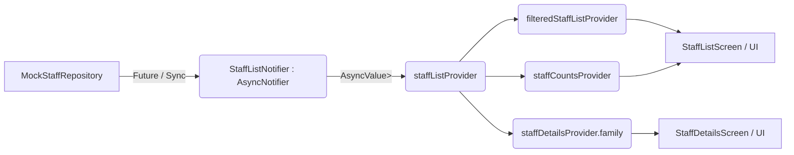

# EduPulse — School Management System (SMS)
## Comprehensive Technical Project Documentation (Admin & Staff Module State)

**Document Version:** 1.0.0  
**Generated Date:** October 21, 2026  
**Primary Target File:** `docs/PROJECT_DOCUMENTATION.md`  
**System Identity:** EduPulse — Enterprise K-12 Institutional Management Platform  

---

## 1. Project Overview & Goal

### 1.1 Executive Summary
**EduPulse** is an enterprise-grade School Management System (SMS) developed using Flutter and Dart. The system is designed to digitalize and streamline core educational administration workflows across multiple stakeholders: **Institutional Administrators**, **Teaching Faculty**, **Non-Teaching & Support Staff**, **Students**, and **Parents/Guardians**.

The application utilizes modern Flutter practices with declarative architecture, modular domain-driven feature boundaries, reactive state management using **Riverpod 2.x**, adaptive responsive UI layouts supporting phone viewports (390x844) through multi-monitor desktop displays, and an offline-first hybrid mock persistence architecture with realistic Indian institutional contexts.

### 1.2 Core Problem Solved
Traditional school software is fragmented, static, and separates administrative faculty tracking from academic timetables, payroll, and credential provisioning. EduPulse addresses this by:
1. **Unifying Faculty & Staff Administration**: Consolidating Teaching, Administrative, and Support personnel into a single 360° directory.
2. **Context-Aware Workflows**: Dynamically toggling academic structures (Class-Subject pairings, Specialization, Primary Class Teacher designations) strictly when a staff member belongs to the teaching category.
3. **Data Security & Privacy**: Masking sensitive compensation, banking (IFSC, Account Numbers), and tax identifiers (PAN, EPF UAN) from unauthorized roles while keeping them audit-ready for Bursars and Administrators.
4. **Instant Physical Badge Generation**: Rendering dual-sided printable NFC/Barcode faculty ID cards directly from employee dossier data.

### 1.3 Development Progress Status
* ✅ **Core Architecture & Shell**: Declarative routing, responsive scaffold, collapsible navigation sidebar, multi-role portal gateway, light/dark themes.
* ✅ **Admissions & Student Module**: Student directory, 4-step admission wizard, pipeline category board, document verification, parent/frontdesk workspaces.
* ✅ **Classes & Academic Hub**: Class management, section configuration, subject assignments, curriculum and daily lesson planning hubs.
* ✅ **Staff Management Module (ADMIN SIDE COMPLETED)**:
  - 15-field data model with Indian school seed dataset.
  - Multi-view directory (Enterprise Data Table + Responsive Card Grid).
  - 4-step onboarding wizard (`AddStaffFormScreen`).
  - Full update flow (`EditStaffScreen`).
  - Soft-deactivation audit flow (`MockStaffRepository.deleteOrDeactivateStaff`).
  - Staff 360° Profile Dossier with 6 interactive tabs: Profile, Class Routine, 30-Day Attendance, Leave Management, Payroll Slips, and Library Circulation.
  - Institutional Department & Headcount Matrix (`StaffDepartmentsScreen`).
  - Official Accounts Ledger & Salary Disbursement Ledger (`StaffAccountsLedgerScreen`).
  - Dual-sided Physical ID Badge View & Thermal Card Print Dispatch.
* ⏳ **Staff-Facing Module (PENDING WORK)**:
  - Common `StaffShellLayout` with role-tailored sidebar and feature access.
  - Staff self-service portal for 6 distinct roles: `principal`, `teacher` (Class Teacher vs Subject Teacher), `accountant`, `librarian`, `transport_manager`, and `receptionist`.

---

## 2. Tech Stack & Dependencies

The complete dependency manifest extracted directly from [pubspec.yaml](file:///c:/Users/rinku/OneDrive/Desktop/KVM/schoolmgnt/frontend/pubspec.yaml):

| Layer / Capability | Package / Technology | Version in `pubspec.yaml` | Architectural Role |
| :--- | :--- | :--- | :--- |
| **Framework & Language** | Flutter SDK & Dart | SDK `>=3.12.2` | Core cross-platform engine (Web, Mobile, Desktop) |
| **State Management** | `flutter_riverpod` | `^2.6.1` | Reactive dependency injection, `AsyncNotifier`, and UI state synchronization |
| **Routing & Navigation** | `go_router` | `^14.8.1` | Declarative URL management & Shell Route infrastructure |
| **Typography & Fonts** | `google_fonts` | `^6.2.1` | Inter typography system across all themes |
| **Vector Graphics** | `flutter_svg` | `^2.0.17` | High-fidelity institutional badges, icons, and SVG illustrations |
| **Localization & Utils** | `intl` | `^0.20.2` | Indian Rupee formatting (`₹`), Date & Time parsing, pluralization |
| **Unique Identifiers** | `uuid` | `^4.5.1` | Cryptographic v4 sequence generation for dynamic mock models |
| **File Handling** | `file_picker` | `^8.1.7` | Document, certificate, and profile photo upload simulation |
| **Local Persistence** | `shared_preferences` | `^2.5.6` | Client-side cache overlay for hot reloads and offline persistence |
| **HTTP Client** | `http` | `^1.6.0` | Connectivity to local Node JSON sync server |
| **Charts & Data Viz** | `fl_chart` | `^1.2.0` | Attendance trends, monthly rate curves, and headcount graphs |
| **Icons** | `cupertino_icons` | `^1.0.8` | Cupertino fallback glyphs |
| **Linting & Quality** | `flutter_lints` | `^6.0.0` | Official Flutter static analysis and lint rule enforceability |

### State Management Pattern
The application uses **Riverpod 2.x** with immutable models. The state flow follows:


---

## 3. Project Folder Structure

```
c:/Users/rinku/OneDrive/Desktop/KVM/schoolmgnt/frontend/
├── assets/
│   ├── data/
│   │   ├── academics/               # Academic syllabi & marking guidelines
│   │   ├── admin/                   # Administrative audit logs & system configs
│   │   ├── admissions/              # Student admissions JSON seeds & intake drafts
│   │   ├── announcements/           # School-wide broadcast messages & notices
│   │   ├── attendance/              # Faculty & student monthly attendance logs
│   │   ├── auth/                    # Mock authentication accounts & demo users
│   │   ├── classes/                 # Section timetables, classrooms & lesson notes
│   │   ├── coursework/              # Assignments & homework records
│   │   ├── examinations/            # Exam schedules, question papers & grade cards
│   │   ├── finance/                 # Fee structures, vouchers & expense ledgers
│   │   ├── staff/
│   │   │   ├── staff.json           # Primary Indian school faculty & staff seed (10+ records)
│   │   │   ├── staff_global.json    # Global institutional staff directory
│   │   │   ├── staff_leaves.json    # Faculty leave records & pending requests
│   │   │   └── staff_library.json   # Staff library circulation records
│   │   ├── students/                # Enrolled student profiles & historical archives
│   │   ├── transfers/               # Student TC (Transfer Certificate) applications
│   │   ├── classes.json             # Grade 1 to 12 definitions & sections
│   │   └── global_school_database.json # Unified school system backup mock
│   ├── icons/                       # Custom SVG and PNG system glyphs
│   └── images/                      # School crest, banners, and placeholder avatars
├── docs/
│   └── PROJECT_DOCUMENTATION.md     # This comprehensive technical document
├── lib/
│   ├── main.dart                    # Application root entry point, theme mode, and navigation switchboard
│   └── src/
│       ├── commonwidgets/           # Shared cross-cutting components
│       │   ├── edupluse_scaffold.dart   # Main dashboard scaffold with collapsible sidebar & topbar
│       │   ├── empty_state_view.dart    # Standardized zero-data display widget
│       │   ├── error_state_view.dart    # Error state presenter with retry callbacks
│       │   ├── loading_indicator.dart   # Consistent circular progress indicators
│       │   ├── logout_button.dart       # Session termination launcher
│       │   └── responsive_layout.dart   # Mobile (<600), Tablet (600-1024), Desktop (>=1024) builder
│       ├── features/
│       │   ├── admissions/          # Student Admissions Module (Admin, Parent, Frontdesk)
│       │   ├── authentication/      # Portal Gateway, Multi-role Hub, User Models
│       │   │   ├── application/     # auth_controller.dart (RoleDirectory & activeUserRoleProvider)
│       │   │   ├── domain/          # user_model.dart (UserModel, UserRole, AccountStatus)
│       │   │   └── presentation/    # portal_gateway_screen.dart, role_workspace_hub_screen.dart
│       │   ├── classes/             # Classes, Sections, Curriculum, Daily Lessons & Timetable
│       │   │   ├── application/     # classes_controller.dart, sections_controller.dart
│       │   │   ├── domain/          # class_model.dart, section_model.dart, subject_model.dart
│       │   │   └── presentation/    # classes_hub_screen.dart, shared tab views
│       │   └── staff/               # Unified Staff Management Module (Admin & Faculty)
│       │       ├── application/
│       │       │   └── staff_controller.dart       # Riverpod providers, notifiers, query filters
│       │       ├── data/
│       │       │   └── staff_repository.dart       # StaffRepository, MockStaffRepository, sync client
│       │       ├── domain/
│       │       │   ├── class_subject_assignment.dart # Pairing matrix model (Grade + Section + Subject)
│       │       │   ├── staff_compensation_model.dart # Salary, bank details, PAN & EPF masking
│       │       │   ├── staff_login_account_model.dart# Institutional portal account provisioning
│       │       │   └── staff_member_model.dart     # Comprehensive 15-field core personnel entity
│       │       └── presentation/
│       │           ├── admin/
│       │           │   ├── add_staff_form_screen.dart       # 4-step responsive staff onboarding wizard
│       │           │   ├── edit_staff_screen.dart           # Pre-populated staff modification wizard
│       │           │   ├── staff_accounts_ledger_screen.dart# Salary disbursement & accounts ledger
│       │           │   ├── staff_departments_screen.dart    # Departmental matrix & HOD roster
│       │           │   ├── staff_details_screen.dart        # 360° Employee dossier with 6 subtabs
│       │           │   ├── staff_list_screen.dart           # Directory with KPI cards, Table & Grid views
│       │           │   └── tabs/
│       │           │       ├── staff_attendance_tab.dart    # Monthly attendance matrix & fl_chart
│       │           │       ├── staff_class_routine_tab.dart # Weekly duty timetable & substitute picker
│       │           │       ├── staff_leave_tab.dart         # Leave applications & approval actions
│       │           │       ├── staff_library_tab.dart       # Reference book borrowing & renewals
│       │           │       ├── staff_payroll_tab.dart       # Monthly salary slips & payslip voucher
│       │           │       └── staff_profile_tab.dart       # Demographic coordinates & document roster
│       │           ├── staff/
│       │           │   └── role_views/                      # [PENDING] Staff-end workspaces (Principal, Teacher, etc.)
│       │           └── widgets/
│       │               ├── class_pairing_box.dart       # Interactive Class-Subject pairing editor
│       │               ├── staff_card.dart              # Reusable employee card with monogram avatar
│       │               └── staff_id_badge_view.dart     # Dual-sided physical ID badge generator
│       ├── locallization/           # Multi-language string tables (.gitkeep)
│       ├── routing/
│       │   └── route_names.dart     # Route constant identifiers
│       ├── themes/
│       │   ├── app_colors.dart      # Design token constants (Primary, Secondary, Surface, Dark)
│       │   └── app_theme.dart       # Material 3 Light & Dark themes with GoogleFonts.inter
│       └── utils/
│           ├── app_constants.dart       # Breakpoints, latency delays, asset paths
│           ├── asset_loader.dart        # rootBundle JSON reader with artificial delay simulation
│           └── dynamic_data_client.dart # Hybrid Data Client (Node HTTP server + SharedPreferences + Cache)
├── pubspec.yaml                     # Dependency specifications & declared asset directories
├── STAFF_MODULE_SPECIFICATION.md    # Approved functional specification for Staff Module
└── README.md                        # Project introductory readme
```

---

## 4. Mock Data Architecture & Persistence Strategy

EduPulse operates on a **Hybrid Data Persistence Architecture** managed by [DynamicDataClient](file:///c:/Users/rinku/OneDrive/Desktop/KVM/schoolmgnt/frontend/lib/src/utils/dynamic_data_client.dart) and [MockStaffRepository](file:///c:/Users/rinku/OneDrive/Desktop/KVM/schoolmgnt/frontend/lib/src/features/staff/data/staff_repository.dart).

```
 ┌─────────────────────────────────────────────────────────────┐
 │                DynamicDataClient.getAll()                   │
 └──────────────────────────────┬──────────────────────────────┘
                                │
               1. Check In-Memory Cache (Instant)
                                │
          ┌─────────────────────┴─────────────────────┐
          ▼                                           ▼
   [Server Online?]                            [Server Offline?]
   GET http://127.0.0.1:8080/api/data         rootBundle.loadString(assets/...)
   (Direct Disk Read/Write)                   (Bundled Seed Assets)
          │                                           │
          └─────────────────────┬─────────────────────┘
                                ▼
         2. Overlay Browser SharedPreferences (Cache Key)
            (Key: `edupulse_saved_staff_records`)
                                ▼
         3. Return Parsed Models & Refresh Riverpod State
```

### 4.1 Persistence Workflow
1. **Initial Seed**: If local storage is empty, records are seeded from [assets/data/staff/staff.json](file:///c:/Users/rinku/OneDrive/Desktop/KVM/schoolmgnt/frontend/assets/data/staff/staff.json).
2. **Local Sync Server Probe**: `DynamicDataClient.checkServerHealth()` pings `http://127.0.0.1:8080/api/health` with a 350ms timeout. If running, mutations are synced directly to disk JSON files.
3. **Browser / Mobile Storage Fallback**: If the server is offline (e.g. running standalone `flutter run -d chrome`), all modifications, newly added staff members, and deactivated staff are serialized and saved into `SharedPreferences` under the key `'edupulse_saved_staff_records'`.
4. **Resilience**: Hot restarts, page refreshes, and role transitions preserve all newly onboarded faculty members.

### 4.2 Sample Seed JSON Record
Direct extract from [assets/data/staff/staff.json](file:///c:/Users/rinku/OneDrive/Desktop/KVM/schoolmgnt/frontend/assets/data/staff/staff.json):
```json
{
  "id": "STF-2026-0101",
  "fullName": "Dr. Rajeshwari Swaminathan",
  "photoUrl": null,
  "category": "teaching",
  "designation": "HOD & Senior PGT Mathematics",
  "department": "Mathematics",
  "qualification": "Ph.D. in Applied Mathematics, M.Sc., B.Ed.",
  "specialization": "Pure Calculus, Advanced Trigonometry & Analytical Geometry",
  "phone": "+91 98450 12345",
  "email": "rajeshwari.swaminathan@edupulse.edu.in",
  "currentAddress": "Flat 402, Kaveri Heights, Indiranagar, Bengaluru, KA 560038",
  "permanentAddress": "Plot 12, Swaminathan Nilayam, Anna Nagar, Chennai, TN 600040",
  "joiningDate": "2020-06-15T09:00:00.000",
  "employmentType": "permanent",
  "assignedClasses": [
    {
      "grade": "Class 10",
      "section": "A",
      "subject": "Mathematics",
      "isClassTeacher": true,
      "periodsPerWeek": 6
    },
    {
      "grade": "Class 12",
      "section": "A",
      "subject": "Advanced Mathematics",
      "isClassTeacher": false,
      "periodsPerWeek": 6
    }
  ],
  "compensation": {
    "basicSalary": 85000.0,
    "payFrequency": "Monthly",
    "bankName": "State Bank of India",
    "accountNumber": "30192847561",
    "ifscCode": "SBIN0004512",
    "panNumber": "ABCPS1234E",
    "epfUan": "100984726152"
  },
  "loginAccount": {
    "isEnabled": true,
    "institutionalEmail": "rajeshwari.swaminathan@edupulse.edu.in",
    "temporaryPassword": null,
    "systemRole": "teacher",
    "isFirstLoginPasswordChangeRequired": false
  },
  "status": "active",
  "gender": "Female",
  "dateOfBirth": "1982-04-12T00:00:00.000",
  "bloodGroup": "O+",
  "emergencyContact": "+91 98450 99887",
  "fatherName": "S. Swaminathan",
  "motherName": "K. Meenakshi",
  "maritalStatus": "Married",
  "experienceYears": 9,
  "previousSchool": "National Public School, Indiranagar",
  "currentSchool": "EduPulse Global Academy (Bengaluru Campus)",
  "bankBranch": "Indiranagar Main Branch",
  "height": "5.6 ft",
  "weight": "62 kg",
  "documents": [
    { "name": "PhdDegreeCertificate.pdf", "size": "3.2 MB" },
    { "name": "BedCertification.pdf", "size": "1.8 MB" },
    { "name": "AppointmentOrder2020.pdf", "size": "2.1 MB" }
  ],
  "socialMedia": {
    "facebook": "https://facebook.com/r.swaminathan",
    "linkedin": "https://linkedin.com/in/rswaminathan-math",
    "instagram": "https://instagram.com/rswaminathan"
  }
}
```

---

## 5. Data Models & Domain Architecture

All domain models are located under [lib/src/features/staff/domain/](file:///c:/Users/rinku/OneDrive/Desktop/KVM/schoolmgnt/frontend/lib/src/features/staff/domain/).

### 5.1 Enums

#### `StaffCategory`
Governs dynamic visibility of academic fields in onboarding and dossier screens:
```dart
enum StaffCategory {
  teaching,
  administrative,
  support;

  String get label {
    switch (this) {
      case StaffCategory.teaching: return 'Teaching Faculty';
      case StaffCategory.administrative: return 'Administrative Staff';
      case StaffCategory.support: return 'Operational Support';
    }
  }
}
```

#### `EmploymentType`
```dart
enum EmploymentType {
  permanent,
  probationary,
  contractual,
  partTime;

  String get label {
    switch (this) {
      case EmploymentType.permanent: return 'Full-Time Permanent';
      case EmploymentType.probationary: return 'Probationary';
      case EmploymentType.contractual: return 'Contractual';
      case EmploymentType.partTime: return 'Visiting / Part-Time';
    }
  }
}
```

#### `StaffStatus`
Controls active status badges and filter queries:
```dart
enum StaffStatus {
  active,
  onLeave,
  inactive;

  String get label {
    switch (this) {
      case StaffStatus.active: return 'Active';
      case StaffStatus.onLeave: return 'On Leave';
      case StaffStatus.inactive: return 'Inactive';
    }
  }
}
```

### 5.2 Core `StaffMemberModel`
From [staff_member_model.dart](file:///c:/Users/rinku/OneDrive/Desktop/KVM/schoolmgnt/frontend/lib/src/features/staff/domain/staff_member_model.dart):
```dart
class StaffMemberModel {
  // 1. Staff ID (Format: STF-2026-XXXX)
  final String id;
  // 2. Full Name
  final String fullName;
  // 3. Profile Photo (URL or Base64 / null)
  final String? photoUrl;
  // 4. Staff Category
  final StaffCategory category;
  // 5. Designation / Job Title
  final String designation;
  // 6. Department
  final String department;
  // 7. Qualification
  final String qualification;
  // 8. Specialization (Teaching Category Only)
  final String? specialization;
  // 9. Contact Coordinates
  final String phone;
  final String email;
  final String currentAddress;
  final String permanentAddress;
  // 10. Date of Joining
  final DateTime joiningDate;
  // 11. Employment Type
  final EmploymentType employmentType;
  // 12. Assigned Classes & Subjects (Teaching Category Only)
  final List<ClassSubjectAssignment> assignedClasses;
  // 13. Salary & Banking Details (Admin/HR Protected)
  final StaffCompensationModel compensation;
  // 14. Login Account & Role Provisioning
  final StaffLoginAccountModel? loginAccount;
  // 15. Active / Inactive Status
  final StaffStatus status;

  // Additional Extended Institutional Demographics
  final String? gender;
  final DateTime? dateOfBirth;
  final String? bloodGroup;
  final String? emergencyContact;
  final String? fatherName;
  final String? motherName;
  final String? maritalStatus;
  final int? experienceYears;
  final String? previousSchool;
  final String? currentSchool;
  final String? bankBranch;
  final String? height;
  final String? weight;
  final List<Map<String, dynamic>>? documents;
  final Map<String, dynamic>? socialMedia;

  const StaffMemberModel({
    required this.id,
    required this.fullName,
    this.photoUrl,
    required this.category,
    required this.designation,
    required this.department,
    required this.qualification,
    this.specialization,
    required this.phone,
    required this.email,
    required this.currentAddress,
    required this.permanentAddress,
    required this.joiningDate,
    required this.employmentType,
    this.assignedClasses = const [],
    required this.compensation,
    this.loginAccount,
    this.status = StaffStatus.active,
    this.gender,
    this.dateOfBirth,
    this.bloodGroup,
    this.emergencyContact,
    this.fatherName,
    this.motherName,
    this.maritalStatus,
    this.experienceYears,
    this.previousSchool,
    this.currentSchool,
    this.bankBranch,
    this.height,
    this.weight,
    this.documents,
    this.socialMedia,
  });

  /// Computed: True if teacher is assigned as Primary Class Teacher for any section
  bool get isClassTeacher => assignedClasses.any((a) => a.isClassTeacher);

  /// Computed: First designated class teacher assignment
  ClassSubjectAssignment? get primaryClassAssignment {
    try {
      return assignedClasses.firstWhere((a) => a.isClassTeacher);
    } catch (_) {
      return null;
    }
  }

  /// Computed: List of distinct class teacher assignments
  List<ClassSubjectAssignment> get classTeacherAssignments {
    final seen = <String>{};
    final list = <ClassSubjectAssignment>[];
    for (final a in assignedClasses.where((e) => e.isClassTeacher)) {
      final key = '${a.grade}-${a.section}';
      if (seen.add(key)) {
        list.add(a);
      }
    }
    return list;
  }

  /// Computed: Monogram string for avatars (e.g. "RS" for Dr. Rajeshwari Swaminathan)
  String get initials {
    final parts = fullName.trim().split(RegExp(r'\s+'));
    if (parts.isEmpty) return 'ST';
    if (parts.length == 1) return parts.first.substring(0, parts.first.length.clamp(1, 2)).toUpperCase();
    int start = 0;
    if (['dr.', 'mr.', 'mrs.', 'ms.', 'prof.'].contains(parts.first.toLowerCase()) && parts.length > 2) {
      start = 1;
    }
    final firstChar = parts[start].isNotEmpty ? parts[start][0] : '';
    final lastChar = parts.last.isNotEmpty ? parts.last[0] : '';
    return '$firstChar$lastChar'.toUpperCase();
  }
}
```

### 5.3 Auxiliary Domain Entities

#### `ClassSubjectAssignment`
From [class_subject_assignment.dart](file:///c:/Users/rinku/OneDrive/Desktop/KVM/schoolmgnt/frontend/lib/src/features/staff/domain/class_subject_assignment.dart):
```dart
class ClassSubjectAssignment {
  final String grade;           // e.g. "Class 10"
  final String section;         // e.g. "A"
  final String subject;         // e.g. "Mathematics"
  final bool isClassTeacher;    // Flag indicating Class Teacher designation
  final int periodsPerWeek;     // Default: 5

  const ClassSubjectAssignment({
    required this.grade,
    required this.section,
    required this.subject,
    this.isClassTeacher = false,
    this.periodsPerWeek = 5,
  });

  String get displayName => '$grade-$section • $subject';
}
```

#### `StaffCompensationModel`
From [staff_compensation_model.dart](file:///c:/Users/rinku/OneDrive/Desktop/KVM/schoolmgnt/frontend/lib/src/features/staff/domain/staff_compensation_model.dart):
```dart
class StaffCompensationModel {
  final double basicSalary;
  final String payFrequency; // Default: 'Monthly'
  final String bankName;
  final String accountNumber;
  final String ifscCode;
  final String panNumber;
  final String? epfUan;

  const StaffCompensationModel({
    required this.basicSalary,
    this.payFrequency = 'Monthly',
    required this.bankName,
    required this.accountNumber,
    required this.ifscCode,
    required this.panNumber,
    this.epfUan,
  });

  /// Returns masked bank account number (e.g. "•••• •••• 4512")
  String get maskedAccountNumber {
    if (accountNumber.length <= 4) return accountNumber;
    final last4 = accountNumber.substring(accountNumber.length - 4);
    final maskedPrefix = '•••• ' * ((accountNumber.length - 4) ~/ 4).clamp(1, 3);
    return '$maskedPrefix$last4';
  }

  /// Returns masked PAN number (e.g. "AB••••••1F")
  String get maskedPanNumber {
    if (panNumber.length <= 4) return panNumber;
    final prefix = panNumber.substring(0, 2);
    final suffix = panNumber.substring(panNumber.length - 2);
    return '$prefix••••••$suffix';
  }
}
```

#### `StaffLoginAccountModel`
From [staff_login_account_model.dart](file:///c:/Users/rinku/OneDrive/Desktop/KVM/schoolmgnt/frontend/lib/src/features/staff/domain/staff_login_account_model.dart):
```dart
class StaffLoginAccountModel {
  final bool isEnabled;
  final String institutionalEmail;
  final String? temporaryPassword;
  final String systemRole; // 'teacher', 'admin', 'frontDesk'
  final bool isFirstLoginPasswordChangeRequired;

  const StaffLoginAccountModel({
    this.isEnabled = true,
    required this.institutionalEmail,
    this.temporaryPassword,
    this.systemRole = 'teacher',
    this.isFirstLoginPasswordChangeRequired = true,
  });
}
```

---

## 6. State Management & Riverpod Providers

All Staff State management logic is consolidated in [lib/src/features/staff/application/staff_controller.dart](file:///c:/Users/rinku/OneDrive/Desktop/KVM/schoolmgnt/frontend/lib/src/features/staff/application/staff_controller.dart).

### 6.1 Complete Staff Provider Directory

| Provider Name | Type | Purpose & Behavior |
| :--- | :--- | :--- |
| `staffRepositoryProvider` | `Provider<StaffRepository>` | Provides the singleton instance of `MockStaffRepository` linked to `DynamicDataClient`. |
| `staffListProvider` | `AsyncNotifierProvider<StaffListNotifier, List<StaffMemberModel>>` | Primary reactive staff list. Manages async retrieval, caching, saving mutations, and soft deactivation. |
| `selectedStaffIdProvider` | `StateProvider<String?>` | Holds the ID of the currently selected staff member for 360° dossier view and edit operations. |
| `staffDetailsProvider` | `Provider.family<StaffMemberModel?, String?>` | Family provider returning the full `StaffMemberModel` matching a given ID from the loaded cache. |
| `staffSearchQueryProvider` | `StateProvider<String>` | Holds the live search string entered by the user in the directory search bar. |
| `staffCategoryFilterProvider` | `StateProvider<StaffCategory?>` | Active filter chip (`null` = All, `teaching`, `administrative`, `support`). |
| `staffDepartmentFilterProvider` | `StateProvider<String?>` | Active department filter selection (`null` / `'All Departments'` = unfiltered). |
| `staffStatusFilterProvider` | `StateProvider<StaffStatus?>` | Active status dropdown filter (`null` = All, `active`, `onLeave`, `inactive`). |
| `filteredStaffListProvider` | `Provider<List<StaffMemberModel>>` | Pure computed provider that filters `staffListProvider` across query, category, department, and status. |
| `staffCountsProvider` | `Provider<StaffCounts>` | Computed metrics provider calculating `total`, `teaching`, `administrative`, `support`, `onLeave`, and `active` counts for KPI cards. |

### 6.2 Notifier Operations in `StaffListNotifier`
```dart
class StaffListNotifier extends AsyncNotifier<List<StaffMemberModel>> {
  @override
  Future<List<StaffMemberModel>> build() async {
    final repo = ref.read(staffRepositoryProvider);
    return repo.getStaffList();
  }

  // Persists additions or updates, then reloads the notifier's data state
  Future<StaffMemberModel> saveStaff(StaffMemberModel staff) async {
    final repo = ref.read(staffRepositoryProvider);
    final saved = await repo.saveStaff(staff);
    state = AsyncValue.data(await repo.getStaffList());
    return saved;
  }

  // Soft-deactivates staff member and updates state
  Future<bool> deactivateStaff(String id) async {
    final repo = ref.read(staffRepositoryProvider);
    final success = await repo.deleteOrDeactivateStaff(id);
    if (success) {
      state = AsyncValue.data(await repo.getStaffList());
    }
    return success;
  }

  // Generates sequence STF-2026-XXXX
  Future<String> getNextStaffId() async {
    final repo = ref.read(staffRepositoryProvider);
    return repo.generateNextStaffId();
  }

  // Forces reload from persistence
  Future<void> refresh() async {
    state = const AsyncValue.loading();
    state = await AsyncValue.guard(() async {
      final repo = ref.read(staffRepositoryProvider);
      return repo.getStaffList();
    });
  }
}
```

---

## 7. Features Implemented Till Now (Admin Staff Management)

The Admin Staff Module is 100% operational with end-to-end CRUD capabilities, reactive filtering, and multi-tab employee dossier screens.

### 7.1 Screen 1: Staff Directory & Roster (`StaffListScreen`)
Located at [staff_list_screen.dart](file:///c:/Users/rinku/OneDrive/Desktop/KVM/schoolmgnt/frontend/lib/src/features/staff/presentation/admin/staff_list_screen.dart).

1. **Top Metric KPI Cards**:
   - **Total Personnel**: Overall institutional headcount.
   - **Teaching Faculty**: Count of educators with academic workload responsibilities.
   - **Administrative**: Count of finance, admissions, HR, and library staff.
   - **On Leave Today**: Real-time count of staff on approved leave.
2. **Real-Time Multi-Facet Filter Toolbar**:
   - Free text search across Full Name, Staff ID, Phone Number, Designation, and Department.
   - Segmented filter chips: `All Staff`, `Teaching Faculty`, `Administrative`, and `Support`.
   - Department selector dropdown with dynamic departments populated from active faculty data.
   - Status selector dropdown (`All Status`, `Active`, `On Leave`, `Inactive`).
3. **Dual Display Layout Modes**:
   - **Table View (`_isGridView = false`)**: High-density enterprise data table showing Monogram/Avatar, Staff ID, Full Name, Category, Department, Designation, Contact, Assigned Classes summary chip (e.g. `Class Teacher (10-A)`), Status chip, and action icon buttons.
   - **Card Grid View (`_isGridView = true`)**: Adaptive 1-to-4 column responsive grid of [StaffCard](file:///c:/Users/rinku/OneDrive/Desktop/KVM/schoolmgnt/frontend/lib/src/features/staff/presentation/widgets/staff_card.dart) widgets showing role tags, contact launchers, class teacher badges, and quick actions.
4. **Action Handlers**:
   - *View 360° Profile*: Sets `selectedStaffIdProvider` and navigates to `EdupluseNavPage.staffDetails`.
   - *Edit Record*: Prefills `_editingStaff` and navigates to `EdupluseNavPage.editStaff`.
   - *Print ID Badge*: Opens modal dialog rendering [StaffIdBadgeView](file:///c:/Users/rinku/OneDrive/Desktop/KVM/schoolmgnt/frontend/lib/src/features/staff/presentation/widgets/staff_id_badge_view.dart) with instant print dispatch.

---

### 7.2 Screen 2: 4-Step Onboarding Wizard (`AddStaffFormScreen`)
Located at [add_staff_form_screen.dart](file:///c:/Users/rinku/OneDrive/Desktop/KVM/schoolmgnt/frontend/lib/src/features/staff/presentation/admin/add_staff_form_screen.dart).

A step-by-step wizard validating all 15 core attributes:
* **Step 1: Personal & Demographic Coordinates**:
  - Auto-generated next sequence ID (`STF-2026-XXXX`).
  - Full Name, Phone, Official Email, Gender, Blood Group, Date of Birth.
  - Current Address and Permanent Address with interactive *"Permanent address same as current address"* sync checkbox.
  - Emergency contact phone.
* **Step 2: Employment & Institutional Placement**:
  - Staff Category segmented button (`Teaching`, `Administrative`, `Support`).
  - Dynamic Department dropdown automatically switching to category-relevant departments.
  - Designation, Educational Qualifications, Date of Joining, and Employment Type.
* **Step 3: Academic Workload & Class Pairings (Context-Aware Conditional)**:
  - **Teaching Category**: Renders Specialization input and [ClassPairingBox](file:///c:/Users/rinku/OneDrive/Desktop/KVM/schoolmgnt/frontend/lib/src/features/staff/presentation/widgets/class_pairing_box.dart). Allows pairing Class (1st to 12th), Section (A-D), Subject, Periods Per Week, and the *"Designate as Primary Class Teacher"* toggle.
  - **Administrative / Support Categories**: Academic fields are hidden; an informational banner is displayed explaining that academic pairings are waived for non-teaching staff.
* **Step 4: Compensation, Banking & Portal Login Provisioning**:
  - Basic Monthly Salary and Pay Frequency.
  - Bank Name, Account Number, IFSC Code, PAN Card Number, EPF UAN Number.
  - *"Provision Portal Login"* toggle switch:
    - Institutional Login Email (auto-generated from staff name).
    - Temporary password field with hide/reveal toggle.
    - Assigned portal role dropdown (`Teacher Portal`, `Front-Desk Workspace`, `System Administrator`).

---

### 7.3 Screen 3: Edit / Update Flow (`EditStaffScreen`)
Located at [edit_staff_screen.dart](file:///c:/Users/rinku/OneDrive/Desktop/KVM/schoolmgnt/frontend/lib/src/features/staff/presentation/admin/edit_staff_screen.dart).

1. Reads the staff member from `widget.initialStaff` or falls back to `selectedStaffIdProvider`.
2. Populates all controllers across demographics, institutional placement, class-subject pairings, and compensation.
3. Allows changing employment status (Active, On Leave, Inactive), updating class assignments, modifying salary details, or re-issuing credentials.
4. On submission, invokes `ref.read(staffListProvider.notifier).saveStaff(updated)` and transitions the administrator directly to the updated 360° dossier.

---

### 7.4 Delete & Deactivation Flow
1. Rather than hard-deleting employee records (which would destroy institutional audit trails, historical attendance logs, and orphaned timetable slots), the system implements an **institutional deactivation** pattern:
   ```dart
   // MockStaffRepository.deleteOrDeactivateStaff(String id)
   final index = _cachedStaff!.indexWhere((s) => s.id == id);
   if (index >= 0) {
     _cachedStaff![index] = _cachedStaff![index].copyWith(status: StaffStatus.inactive);
     await _persistCache();
     return true;
   }
   ```
2. Deactivated staff members immediately reflect as `Inactive` with gray status badges, are deducted from active teaching counts in `staffCountsProvider`, and can be filtered or reactivated at any time.

---

### 7.5 Screen 4: Staff 360° Profile Dossier (`StaffDetailsScreen`)
Located at [staff_details_screen.dart](file:///c:/Users/rinku/OneDrive/Desktop/KVM/schoolmgnt/frontend/lib/src/features/staff/presentation/admin/staff_details_screen.dart).

Features:
- **Top Bar**: Back button to Staff Directory and a **Quick Personnel Switcher** dropdown to jump directly between staff profiles without navigating back.
- **Hero Banner**: Employee avatar with category gradient, Full Name, Designation, Department tag, Staff ID badge, Active Status badge, and Edit / Print ID Card buttons.
- **6 Dedicated Subtabs**:

```
 ┌────────────────────────────────────────────────────────────────────────────────────────┐
 │ [👤 Profile Details] [📅 Class Routine] [📊 Attendance] [✈️ Leave] [💰 Payroll] [📚 Library] │
 └────────────────────────────────────────────────────────────────────────────────────────┘
```

1. **Profile Details Tab (`StaffProfileTab`)**:
   - Comprehensive profile dossier: Date of Birth, Marital Status, Highest Qualification, Total Experience, Father's and Mother's names.
   - Previous School employment history and Current School placement.
   - Current and Permanent Address cards.
   - Bank Details card with masked account numbers.
   - Medical details (Blood group, height, weight, emergency contact).
   - Document repository listing verified uploaded certificates (Ph.D. Degree, B.Ed. Certificate, Appointment Orders).
   - Social media links (LinkedIn, Twitter, Facebook).
   - Institutional conduct and appraisal description.
2. **Class Routine & Duty Schedule Tab (`StaffClassRoutineTab`)**:
   - Day-by-day timetable for teachers (Monday to Sunday) showing period timings, room numbers, class sections, and subjects.
   - Duty schedule for non-teaching personnel.
   - **Substitute Teacher Assignment Action**: When a staff member is on leave, an admin can assign substitute faculty to specific period slots with audit notes.
3. **Attendance Tab (`StaffAttendanceTab`)**:
   - 5 KPI summary cards: Present (227), Absent (70), Half Day (27), Late (28), Holidays (12).
   - Academic Year filter dropdown (`2026/2027`, `2025/2026`, `2024/2025`).
   - Interactive Chart Mode switcher powered by `fl_chart`:
     - Line Chart mode: Shows monthly attendance rate curve.
     - Bar Chart mode: Visualizes Present vs Absent breakdown per month.
   - 30-day attendance matrix table with color-coded day cells (Green = Present, Amber = Late/Half-Day, Red = Absent).
4. **Leave Management Tab (`StaffLeaveTab`)**:
   - Tabular roster of staff leave applications (Casual, Sick, Maternity, Earned).
   - Date range, duration in days, submission date, and approval status chips.
   - Inline **Approve** and **Reject** action buttons for administrators.
   - Leave rejection dialog with required reason input.
5. **Payroll & Compensation Tab (`StaffPayrollTab`)**:
   - Financial KPI cards: Total Net Salary Disbursed, Gross Earnings, and Total Deductions (PF, ESI, TDS).
   - Interactive invoice voucher history table formatted in Indian Rupees (`₹`).
   - *"View Payslip"* modal dialog: Renders official school salary slip with basic pay, allowances, deductions, and print button.
   - *"Open in Accounts"* action button that navigates directly to the official Accounts Ledger.
6. **Library Circulation Tab (`StaffLibraryTab`)**:
   - Active and historical reference book borrowings for the faculty member.
   - Book title, accession number, category, borrowing date, return deadline, and circulation status (`Issued`, `Returned`, `Overdue`).
   - Quick return and renewal actions.

---

### 7.6 Screen 5: Departments & Faculty Roster (`StaffDepartmentsScreen`)
Located at [staff_departments_screen.dart](file:///c:/Users/rinku/OneDrive/Desktop/KVM/schoolmgnt/frontend/lib/src/features/staff/presentation/admin/staff_departments_screen.dart).

- Institutional department headcount matrix grouping staff by department (Mathematics, Science, Humanities, Computer Science, Accounts & Finance, Library, Campus Operations, etc.).
- Identifies Department Heads (HODs / Bursars) with gold crown badges.
- Member chip grid with direct navigation into individual staff profiles.

---

### 7.7 Screen 6: Official Accounts & Salary Ledger (`StaffAccountsLedgerScreen`)
Located at [staff_accounts_ledger_screen.dart](file:///c:/Users/rinku/OneDrive/Desktop/KVM/schoolmgnt/frontend/lib/src/features/staff/presentation/admin/staff_accounts_ledger_screen.dart).

- High-density institutional financial ledger navigated from the Payroll tab.
- Masked banking details header with unmask/reveal toggle.
- Monthly disbursement vouchers (`ACC-VCH-2026-XX`) with Gross Pay, Deductions, Net Amount, Transfer Mode (NEFT / RTGS), Bank Reference Number, and Clearance Status.
- Printable voucher modal dialog formatted for institutional auditing.

---

## 8. Staff Roles & Access Logic

The system is designed around **6 distinct institutional staff roles** for the staff-facing side, combined with the `isClassTeacher` boolean flag for academic faculty:

```
┌─────────────────────────────────────────────────────────────────────────────────┐
│                           EduPulse Staff Roles                                  │
├────────────────────┬────────────────────────────────────────────────────────────┤
│ 1. principal       │ Executive oversight, institutional sign-offs, school audits│
│ 2. teacher         │ Academic instruction, syllabus, timetables, and grading    │
│    ├─ isClassTeacher = true  (Class Teacher: Attendance, reports, discipline)   │
│    └─ isClassTeacher = false (Subject Teacher: Subject marks, daily coursework) │
│ 3. accountant      │ Fee ledgers, disbursements, payroll vouchers, bursar logs │
│ 4. librarian       │ Book cataloging, ISBNs, circulation desk, overdue fines    │
│ 5. transport_manager│ Bus routes, vehicle fleet, drivers, student transit rosters│
│ 6. receptionist    │ Visitor logs, walk-in inquiries, gate passes, post/courier │
└────────────────────┴────────────────────────────────────────────────────────────┘
```

### 8.1 Detailed Role Responsibilities

| Staff Role | Primary Purpose & Key Capabilities | Accessible Modules / Features |
| :--- | :--- | :--- |
| **`principal`** | **Executive Head of School**: Complete institutional administrative oversight. Approves staff leave applications, signs off on salary disbursements, oversees admissions pipeline, reviews school-wide attendance analytics, and broadcasts announcements. | Executive Dashboard, All Staff Dossiers, Leave Sign-offs, Fee Reports, Admissions Sign-offs, School Calendar, Timetable Master. |
| **`teacher`** | **Academic Educator**: Instruction, lesson delivery, assignments, and student assessment. Differentiated by `isClassTeacher`: | My Timetable, Enrolled Subjects, Lesson Plans, Homework Tracker, Library Reference Desk. |
| ↳ **Class Teacher** (`isClassTeacher == true`) | **Section In-Charge**: Assigned to a specific class & section (e.g., Class 10-A). Has elevated classroom authority: takes daily morning roll-call attendance, compiles term report cards, manages student behavioral notes, and communicates directly with section parents. | Section Roster, Section Attendance Desk, Report Card Generator, Student Behavioral Dossier, Parent Communication Bridge. |
| ↳ **Subject Teacher** (`isClassTeacher == false`) | **Subject Instructor**: Teaches specific subjects across multiple sections (e.g., Physics for 11-A and 12-B). Focuses strictly on subject-wise assignments, coursework submissions, and subject test grading. | Subject Homework Dispatcher, Exam Marks Entry, Syllabus Progress Tracker. |
| **`accountant`** | **Bursar & Finance Officer**: Manages the school treasury, fee receipts, payment gateways, staff salary disbursements, tax deductions (TDS, PF, ESI), and vendor invoice vouchers. | Fee Collection Studio, Defaulter Tracking, Staff Payroll Disbursement, Bank Voucher Generator, Financial Reports. |
| **`librarian`** | **Library Resource Head**: Oversees the school physical and digital library catalog, book accession numbering, barcoded issue/return circulation, overdue fine calculations, and book acquisition requests. | Catalog Management, Circulation Desk (Issue/Return), Student & Staff Borrowing Ledgers, Overdue Fine Receipts. |
| **`transport_manager`** | **Logistics & Fleet Supervisor**: Manages school buses, routes, driver contacts, vehicle maintenance schedules, GPS tracking linkages, and student pickup/drop-off stop assignments. | Fleet Management, Bus Route Mapping, Transit Roster per Bus, Driver Roster, Vehicle Fitness & Fuel Logs. |
| **`receptionist`** | **Front-Desk Officer**: Manages the school reception, logs walk-in visitor passes, registers parent admission inquiries, handles phone inquiries, and tracks institutional couriers/mail. | Visitor Pass Studio, Inquiry Walk-In Register, Gate Pass Dispatcher, Courier & Dispatch Logbook. |

### 8.2 Role Permission Matrix

| Feature / Screen | Principal | Teacher (Class) | Teacher (Subject) | Accountant | Librarian | Transport Mgr | Receptionist | Admin (Super) |
| :--- | :---: | :---: | :---: | :---: | :---: | :---: | :---: | :---: |
| **View Full Staff Directory** | Yes | Directory Only | Directory Only | Directory Only | Directory Only | Directory Only | Directory Only | Full Access |
| **Onboard / Edit Staff Records**| Yes | No | No | No | No | No | No | Yes |
| **Approve / Reject Staff Leaves**| Yes | No | No | No | No | No | No | Yes |
| **View Other Staff Salaries** | Yes | No (Masked) | No (Masked) | Yes (Bursar) | No (Masked) | No (Masked) | No (Masked) | Yes |
| **Mark Student Class Attendance**| Yes | **Yes (Own Class)**| No | No | No | No | No | Yes |
| **Enter Subject Exam Marks** | Yes | Yes | Yes | No | No | No | No | Yes |
| **Disburse Payroll & Vouchers** | Sign-off | No | No | **Full Control** | No | No | No | Full Control |
| **Circulate Library Books** | Yes | Borrow Only | Borrow Only | No | **Full Control** | No | No | Full Control |
| **Manage Bus Fleet & Routes** | Yes | No | No | No | No | **Full Control** | No | Full Control |
| **Issue Visitor & Gate Passes** | Yes | No | No | No | No | No | **Full Control** | Full Control |

---

## 9. Screens & Widgets Inventory

### 9.1 Screen Inventory

| Screen Name | Class Name | File Path | Route / Navigation Enum | Purpose & Features |
| :--- | :--- | :--- | :--- | :--- |
| **Staff Directory** | `StaffListScreen` | `src/features/staff/presentation/admin/staff_list_screen.dart` | `EdupluseNavPage.staffList` | Master staff directory with KPI cards, search, category pills, department filter, and Table/Grid views. |
| **Add New Staff** | `AddStaffFormScreen` | `src/features/staff/presentation/admin/add_staff_form_screen.dart` | `EdupluseNavPage.addNewStaff` | 4-step responsive wizard onboarding new staff with dynamic academic fields for teachers. |
| **Edit Staff Record** | `EditStaffScreen` | `src/features/staff/presentation/admin/edit_staff_screen.dart` | `EdupluseNavPage.editStaff` | Pre-populated 4-step wizard modifying personal, HR, academic, or compensation details. |
| **Staff 360° Profile** | `StaffDetailsScreen` | `src/features/staff/presentation/admin/staff_details_screen.dart` | `EdupluseNavPage.staffDetails` | Complete dossier with top personnel switcher and 6 tabs: Profile, Routine, Attendance, Leave, Payroll, Library. |
| **Departments Matrix**| `StaffDepartmentsScreen`| `src/features/staff/presentation/admin/staff_departments_screen.dart`| `EdupluseNavPage.staffDepartments`| Institutional headcount matrix, departmental roster, and HOD leadership list. |
| **Accounts Ledger** | `StaffAccountsLedgerScreen`| `src/features/staff/presentation/admin/staff_accounts_ledger_screen.dart`| `EdupluseNavPage.accounts` | Official salary disbursement ledger with voucher modal dialog and bank clearance status. |
| **Portal Gateway** | `PortalGatewayScreen` | `src/features/authentication/presentation/portal_gateway_screen.dart` | Initial / null active role | Multi-role gateway allowing one-click sign-in across Admin, Teacher, Student, Parent, Finance, Admissions. |
| **Role Workspace Hub**| `RoleWorkspaceHubScreen` | `src/features/authentication/presentation/role_workspace_hub_screen.dart`| Active non-admin role | Dedicated landing hub for non-admin roles displaying key role capabilities. |
| **Classes Hub** | `ClassesHubScreen` | `src/features/classes/presentation/shared/classes_hub_screen.dart` | `EdupluseNavPage.classes*` | Classes, sections, subjects, timetables, and curriculum manager. |

### 9.2 Reusable Widgets Inventory

| Widget Name | File Path | Purpose & Key Features |
| :--- | :--- | :--- |
| `EdupluseScaffold` | `src/commonwidgets/edupluse_scaffold.dart` | Master application scaffold featuring expandable sidebar, top navigation bar, active user preview, notifications, language indicator, and theme toggle. |
| `StaffCard` | `src/features/staff/presentation/widgets/staff_card.dart` | Employee card featuring category gradient monogram avatar, designation, department chip, class teacher badge, phone/email launchers, and ID badge triggers. |
| `StaffIdBadgeView` | `src/features/staff/presentation/widgets/staff_id_badge_view.dart` | High-resolution CR80 dual-sided staff ID badge renderer with Front/Reverse side choice chips and thermal printer dispatch action. |
| `ClassPairingBox` | `src/features/staff/presentation/widgets/class_pairing_box.dart` | Dynamic class-subject assignment manager with dropdown selectors for Grade, Section, Subject, and Primary Class Teacher checkbox. |
| `ResponsiveLayout` | `src/commonwidgets/responsive_layout.dart` | Utility builder adapting views across Mobile (<600px), Tablet (600-1024px), and Desktop (>=1024px). |
| `LogoutButton` | `src/commonwidgets/logout_button.dart` | Session termination button clearing `activeUserRoleProvider` and returning to the Portal Gateway. |
| `EmptyStateView` | `src/commonwidgets/empty_state_view.dart` | Consistent placeholder widget for zero-data states. |
| `ErrorStateView` | `src/commonwidgets/error_state_view.dart` | Standardized error presenter with error message and retry button. |
| `LoadingIndicator`| `src/commonwidgets/loading_indicator.dart` | Branded circular loading indicator. |

---

## 10. How to Run the Project

### 10.1 System Prerequisites
- **Flutter SDK**: Version `3.22.x` or higher (compatible with Dart `^3.12.2`).
- **Web Browser**: Google Chrome or Microsoft Edge.
- **Node.js** *(Optional)*: If running the local disk sync server for direct file writes.

### 10.2 Installation Steps
1. Open terminal in the project directory:
   ```bash
   cd c:/Users/rinku/OneDrive/Desktop/KVM/schoolmgnt/frontend
   ```
2. Fetch dependencies:
   ```bash
   flutter pub get
   ```
3. Verify static analysis:
   ```bash
   flutter analyze
   ```

### 10.3 Running the Application
Launch the web development server:
```bash
flutter run -d chrome
```
*The app automatically starts on Chrome with hot-reload enabled (`r` in terminal).*

### 10.4 Running Unit & Widget Tests
Execute the automated test suite:
```bash
flutter test
```

---

## 11. Pending Work & Next Steps (Staff End Architecture)

While the **Admin Staff Management Module is fully completed**, the dedicated **Staff-Facing User Experience (Staff End)** is the primary pending architectural deliverable.

### 11.1 The Missing Architectural Component: `StaffShellLayout`
Currently, non-admin roles render either a generic `RoleWorkspaceHubScreen` or the Admin console. The Staff end requires a dedicated, unified shell: **`StaffShellLayout`** (to be implemented in `src/features/staff/presentation/staff/`).

```
┌────────────────────────────────────────────────────────────────────────┐
│                          StaffShellLayout                              │
│                                                                        │
│ ┌───────────────────────────┬────────────────────────────────────────┐ │
│ │ Role-Based Dynamic Menu   │ Topbar: User Avatar, Badge, Role Tag  │ │
│ │ ───────────────────────── │ ────────────────────────────────────── │ │
│ │ • Principal Views         │                                        │ │
│ │ • Class Teacher Roster    │ Main Content Workspace:                │ │
│ │ • Subject Marks Entry     │ (Renders active role workspace view)   │ │
│ │ • Accounts Ledger Desk    │                                        │ │
│ │ • Library Desk            │                                        │ │
│ │ • Transport Fleet         │                                        │ │
│ │ • Reception Desk          │                                        │ │
│ └───────────────────────────┴────────────────────────────────────────┘ │
└────────────────────────────────────────────────────────────────────────┘
```

### 11.2 Required Workspaces to Build in `lib/src/features/staff/presentation/staff/role_views/`
The directory [lib/src/features/staff/presentation/staff/role_views/](file:///c:/Users/rinku/OneDrive/Desktop/KVM/schoolmgnt/frontend/lib/src/features/staff/presentation/staff/role_views/) is currently empty and will house:

1. **`principal_workspace_screen.dart`**:
   - Executive dashboard with school-wide attendance, pending leave sign-offs, fee collection trends, and disciplinary notices.
2. **`teacher_workspace_screen.dart`**:
   - **Adaptive Class Teacher vs Subject Teacher View**:
     - *If `staff.isClassTeacher == true`*: Shows Section Daily Attendance Desk (Present/Late/Absent toggle for their assigned section), Class 10-A Student Dossier, and Class Announcements.
     - *If `staff.isClassTeacher == false`*: Shows Enrolled Subject Timetable, Homework Dispatch Studio, and Subject Test Marks Entry.
3. **`accountant_workspace_screen.dart`**:
   - Fee counter collection register, overdue fee notices, staff payroll disbursement execution, and bank reconciliation ledger.
4. **`librarian_workspace_screen.dart`**:
   - Book catalog search, barcode scanner simulator for issue/return, and overdue fines collection ledger.
5. **`transport_workspace_screen.dart`**:
   - Bus route visualizer, driver roster, vehicle inspection checklists, and student bus stop assignment roster.
6. **`receptionist_workspace_screen.dart`**:
   - Walk-in parent inquiry registrar, visitor badge generator, and student gate pass creator.

### 11.3 Implementation Roadmap for Staff End
1. **Domain & Auth Bridge**:
   - Map `StaffLoginAccountModel.systemRole` and `StaffMemberModel.category` directly to the active session when a staff member logs in via `PortalGatewayScreen`.
2. **`StaffShellLayout` Scaffold**:
   - Build a lightweight shell that reads `currentUserProfileProvider`, detects the active staff role (`principal`, `teacher`, `accountant`, etc.), and filters the sidebar navigation items according to the Role Permission Matrix.
3. **Role View Assembly**:
   - Implement the 6 dedicated workspace screens inside `src/features/staff/presentation/staff/role_views/`.
4. **Testing & Responsiveness**:
   - Validate phone screen rendering (390x844) with zero `RenderFlex` overflow exceptions across all staff-end screens.

---
*Documentation maintained by the EduPulse Engineering Team. For questions or architecture reviews, refer to [STAFF_MODULE_SPECIFICATION.md](file:///c:/Users/rinku/OneDrive/Desktop/KVM/schoolmgnt/frontend/STAFF_MODULE_SPECIFICATION.md) and [AGENTS.md](file:///c:/Users/rinku/OneDrive/Desktop/KVM/schoolmgnt/frontend/AGENTS.md).*
